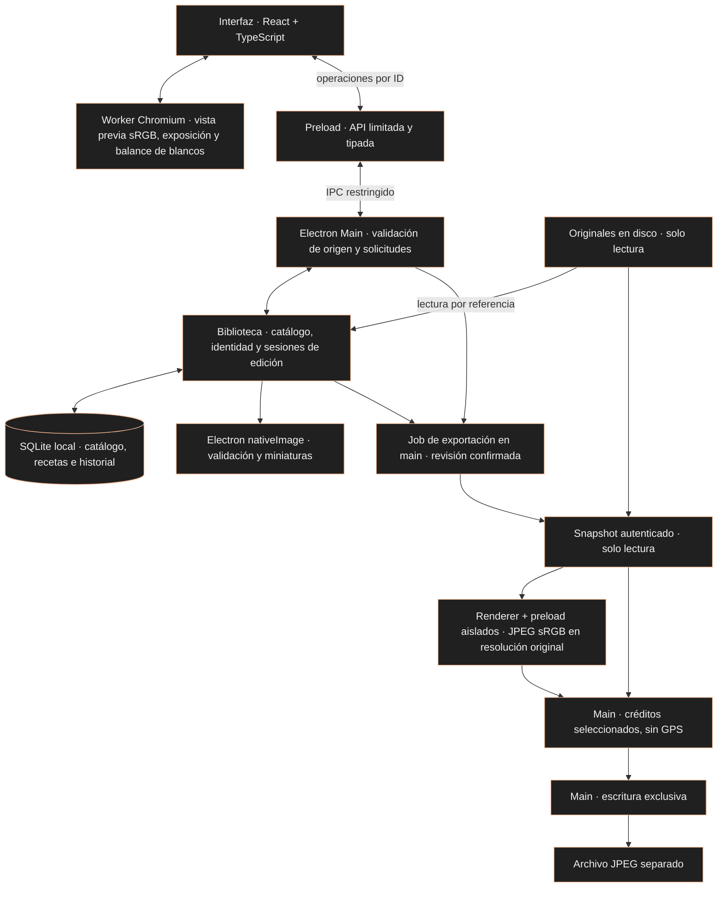

<a id="topo"></a>
<div align="center">

<h1>Revelumo</h1>
<p><a href="README.md">English</a> · <a href="README.pt-BR.md">Português (Brasil)</a> · <strong>Español</strong></p>
<p><strong>Tus fotografías. En tu ordenador.</strong></p>
<p>Un editor fotográfico de escritorio independiente para aficionados y entusiastas.<br>Una biblioteca local para organizar y editar archivos JPEG, conservando los originales.</p>
<p><strong>Local · Sin suscripción · Sin funciones de IA en el producto</strong></p>


<p><sub>Catálogo Cobre real en la aplicación Linux empaquetada, con JPEG importados mediante el propio programa. Build de desarrollo, sin instalador público. <a href="docs/assets/screenshots/README.md">Detalles de las capturas y créditos de las fotos</a>.</sub></p>

<p>
<a href="https://github.com/glaucia86/revelumo/actions/workflows/ci.yml"></a>
<a href="LICENSE"></a>


</p>
</div>

---

## Índice

- [Visión del proyecto](#visao)
- [Interfaz en funcionamiento](#interface)
- [Funciones actuales y límites](#status)
- [Prueba la aplicación](#instalacao)
- [Desarrollo y verificaciones](#desenvolvimento)
- [Arquitectura y Rust](#arquitetura)
- [Hoja de ruta](#roadmap)
- [Cómo contribuir](#contributing)
- [Soporte y seguridad](#support)
- [Licencia y terceros](#license)
- [Sobre la creadora](#creator)

> **Versión preliminar de desarrollo.** Revelumo ya tiene una interfaz de escritorio funcional: biblioteca, valoraciones, filtros, edición de exposición con historial persistente y balance de blancos relativo. Todavía no hay una versión publicada ni un instalador para el público. Para probarlo, es necesario ejecutar el proyecto desde el código fuente. El MVP y la validación multiplataforma siguen en desarrollo.

<a id="visao"></a>
## La fotografía se queda contigo

- **Biblioteca local.** El catálogo y los ajustes permanecen en tu ordenador, sin procesamiento de fotos ni sincronización en la nube.
- **Originales conservados.** La importación registra una referencia al archivo. La aplicación no mueve ni sobrescribe la fotografía.
- **Edición no destructiva.** La exposición y el balance de blancos relativo se almacenan como una receta independiente y se aplican a la vista previa.
- **Desarrollo independiente.** El coste cero y la ausencia de suscripción orientan el proyecto. El código y la documentación originales están bajo MIT, con los derechos de terceros conservados.

Lightroom Classic es una referencia funcional para el flujo de biblioteca y edición. Revelumo tiene identidad propia, sin relación con Adobe ni promesa de ofrecer las mismas funciones.

<a id="interface"></a>
## Una interfaz que ya funciona

La aplicación abre una ventana de Electron con una interfaz React. Puedes importar archivos JPEG, explorar miniaturas, valorar fotos y filtrar la biblioteca. Al abrir una foto, puedes ajustar la exposición y el balance de blancos relativo, comparar con 0 EV manteniendo el balance de blancos y deshacer o rehacer cambios de exposición.

### El catálogo actual

La imagen principal muestra el catálogo **A · Cobre** implementado: entorno oscuro neutro, detalles en cobre, JPEG locales y filtros de biblioteca. Las imágenes se importaron realmente en la aplicación empaquetada. [Implementación y verificación](evidence/cobre-catalog/report.md).

### Editar una foto


El editor ya ofrece exposición, balance de blancos relativo, guardado automático e historial de exposición. Esta es su interfaz funcional actual; el rediseño completo del editor en Cobre sigue planificado. [Detalles de las capturas y créditos de las fotos](docs/assets/screenshots/README.md).

**Idiomas:** el catálogo, la importación, la estructura de la aplicación y el editor existente ofrecen portugués de Brasil, inglés y español mediante un selector persistente. Incluye exposición, balance de blancos relativo, historial, comparación, estrellas/marcas, reubicación y mensajes de recuperación. El primer inicio sigue los idiomas del sistema, con inglés como alternativa. La exportación JPEG también está traducida; el recorte sigue pendiente.

<a id="status"></a>
## Qué puedes hacer hoy

| Función | Disponible en la implementación actual |
| :--- | :--- |
| Importar archivos JPEG | Selección múltiple por referencia, progreso y errores por archivo; volver a importar la misma ruta canónica reutiliza la entrada del catálogo |
| Explorar la biblioteca | Cuadrícula de miniaturas derivadas, 48 fotos por página y vista previa de la foto seleccionada |
| Valorar fotos | De 1 a 5 estrellas o sin valoración; estados seleccionada, rechazada y sin marca |
| Filtrar la biblioteca | Valoración mínima o sin valoración, combinada con una marca; los filtros se conservan al volver de la vista previa durante la sesión |
| Localizar originales | Aviso de archivo ausente y relocalización individual por identidad SHA-256, conservando el ID, la valoración y los ajustes |
| Ajustar la exposición | De −3 a +3 EV en pasos de 0,1 EV, con ganancia en RGB lineal; comparación con 0 EV y restablecimiento |
| Ajustar el balance de blancos | Temperatura y matiz relativos de −100 a +100, en pasos enteros; restablecimiento de ambos sin cambiar la exposición |
| Guardar ajustes | Receta en SQLite, guardado automático y confirmación antes de salir del editor o cerrar normalmente |
| Deshacer y rehacer | Historial de exposición persistente con los últimos 100 pasos por foto, sin caducidad temporal |

### Un flujo para probar

1. Pulsa **Importar JPEGs** (Importar archivos JPEG) y selecciona fotografías en tu ordenador.
2. Abre una miniatura, asigna estrellas o una marca y vuelve a la cuadrícula para filtrar la biblioteca.
3. Abre una foto y ajusta **Exposição** (Exposición) con el control deslizante o el campo numérico.
4. Ajusta **Temperatura** y **Matiz**, o usa **Redefinir balanço de branco** (Restablecer balance de blancos). Son controles relativos, sin escala Kelvin.
5. Prueba **Comparar com 0 EV** (Comparar con 0 EV), **Redefinir exposição** (Restablecer exposición), **Desfazer exposição** (Deshacer exposición) y **Refazer exposição** (Rehacer exposición).
6. Espera la confirmación de guardado. Cierra y vuelve a abrir la aplicación para continuar con el catálogo, la receta y el historial guardados.

Un arrastre completo o una edición numérica finalizada representa un paso del historial, aunque el guardado automático se ejecute durante una pausa. Un nuevo ajuste después de deshacer elimina la posibilidad de rehacer los pasos anteriores. Al superar 100 pasos, los más antiguos dejan de estar disponibles. El historial actual solo cubre la exposición. Cambiar el balance de blancos no crea un paso de exposición ni elimina la posibilidad de rehacer; deshacer exposición conserva el balance de blancos. [Comportamiento y límites](docs-agents/issue-16-contract.md).

### Límites importantes

- **JPEG en esta etapa:** hasta 32 MiB y 40 megapíxeles por archivo, dentro de los tipos aceptados por la validación inicial. RAW y HEIC todavía no son compatibles.
- **Vista previa de edición:** derivada en sRGB, con hasta 2048 px en el lado más largo. No es una exportación a resolución original; la gama de color, el recorte de valores y la cuantización limitan la vista previa.
- **Color y orientación:** se han verificado imágenes sintéticas sRGB/Display-P3 y orientaciones EXIF 1–8 en Electron. La compatibilidad amplia con cámaras, perfiles ICC y flujos profesionales todavía debe evaluarse.
- **Persistencia:** tras una interrupción, se recupera el último estado realmente guardado. Los cambios posteriores aún no guardados pueden perderse.
- **Originales:** el catálogo no es una copia de seguridad. Conserva tus propias copias de las fotos y del catálogo.
- **Balance de blancos relativo:** ajusta un JPEG ya renderizado, sin representar la temperatura de la cámara ni el revelado RAW. No hay cuentagotas, preajustes ni balance automático. [Comportamiento y verificación](docs-agents/adr/0005-jpeg-white-balance.md).
- **Exportación JPEG:** usa **Exportar JPEG** en el editor. La aplicación confirma los ajustes actuales y pide un nuevo nombre de archivo local. Crea un JPEG a resolución original, calidad Chromium 0,90 y sRGB, con exposición/balance de blancos y orientación aplicados. Conserva autoría/copyright seleccionados y elimina metadatos GPS. Nunca reemplaza archivos existentes ni originales. Esta versión limita la salida a 32 MiB y rechaza resultados mayores sin reducir la calidad ni la resolución. “Calidad 90” significa el parámetro fijo 0,90 del encoder Chromium; no garantiza calidad ni submuestreo de color equivalentes entre encoders.
- **Todavía en desarrollo:** recorte. Las recetas desconocidas, incluidas las que contienen recorte, se rechazan en lugar de exportarse sin sus ajustes.

<details>
<summary>Cómo funciona la relocalización de un original</summary>

La miniatura permanece en el catálogo cuando el original cambia de ubicación. La cuadrícula comprueba la disponibilidad al cargar una página, volver a la aplicación o pulsar **Verificar disponibilidade** (Comprobar disponibilidad), sin leer ni calcular el hash de todos los originales. La presencia del archivo no demuestra su integridad; la foto seleccionada recibe la comprobación completa.

**Localizar original** acepta un archivo cada vez y exige exactamente los mismos bytes, verificados mediante SHA-256. Se conservan el ID, el nombre del catálogo y los datos asociados. Volver a importar contenido diferente en la misma ruta no sustituye silenciosamente la identidad registrada.

Una entrada antigua sin identificación cuyo original ya esté ausente no puede volver a vincularse de forma segura. En ese caso, puedes importar el archivo como una nueva entrada y conservar la anterior. [Política de identidad](docs-agents/adr/0003-original-identity-relocation.md) · [Verificaciones de relocalización](evidence/relocation-windows/report.md).

</details>

<a id="instalacao"></a>
## Cómo probarlo

**Todavía no hay un instalador `.exe`, una imagen `.dmg` ni un paquete Linux publicados como versión para el público.** Los siguientes comandos preparan una copia de desarrollo en tu ordenador. El empaquetado genera una carpeta de aplicación; no instala Revelumo en el sistema.

### Requisitos previos

- [Git](https://git-scm.com/downloads).
- [Node.js 24](https://nodejs.org/en/download), con npm. Es la versión utilizada por CI.
- Conexión a Internet para descargar el código, las dependencias y el binario oficial de Electron.
- Una sesión gráfica para abrir la aplicación. En Linux también se necesitan las bibliotecas de sistema que Electron requiere en tu distribución.

Comprueba en el terminal:

```sh
git --version
node --version
npm --version
```

No necesitas instalar un servidor SQLite aparte: el catálogo usa el SQLite incluido en el entorno de ejecución Node/Electron. Consulta los [requisitos de desarrollo de Electron](https://www.electronjs.org/docs/latest/tutorial/tutorial-prerequisites).

### Preparar el código fuente

En **PowerShell o Símbolo del sistema en Windows**, **Terminal en macOS** o un **terminal de Linux**, ejecuta:

```sh
git clone https://github.com/glaucia86/revelumo.git
cd revelumo
npm ci
npm run install:electron
npm run typecheck
npm test
```

`npm ci` utiliza el archivo de bloqueo del repositorio. `install:electron` descarga el binario oficial necesario para esta versión de Electron, que no lo instala automáticamente junto con el paquete npm. Si un comando falla, resuelve el error antes de continuar.

### Abrirlo en tu sistema

| Sistema | Entorno de desarrollo | Qué se ha verificado |
| :--- | :--- | :--- |
| Windows | PowerShell o Símbolo del sistema; utiliza los comandos comunes de esta sección | Paquete x64, pruebas e integración automatizada de Electron; inspección visual y diálogo nativo de Windows aún pendientes |
| macOS | Terminal; los mismos comandos son el punto de partida | Todavía no validado en macOS, Intel ni Apple Silicon; no se garantiza la ejecución en esta etapa |
| Linux | Terminal en una sesión gráfica; utiliza los comandos comunes | Paquete x64 abierto y flujos inspeccionados visualmente en un entorno Linux; esto no establece compatibilidad con todas las distribuciones |

Para iniciar el modo de desarrollo:

```sh
npm start
```

Este comando está configurado en el proyecto, pero su flujo completo todavía no se ha validado de extremo a extremo. Las pruebas existentes se centran en la aplicación empaquetada.

Como alternativa, genera el paquete local en tu propio sistema:

```sh
npm run package
```

El resultado queda en `out/`. En los destinos x64 ya empaquetados, el ejecutable está en:

- **Windows:** `out/Revelumo-win32-x64/Revelumo.exe`.
- **Linux:** `out/Revelumo-linux-x64/Revelumo`.
- **macOS:** el resultado `.app` todavía debe generarse y validarse para este proyecto.

El ejecutable de Windows en esta carpeta es un paquete de desarrollo, no un instalador. Mantén juntos los archivos de la carpeta. La configuración actual usa `makers: []`: `npm run make` todavía no es un flujo preparado para generar instaladores. [Diferencia entre package y make en Forge](https://www.electronforge.io/cli).

> Todavía no se han establecido las versiones mínimas de los sistemas, las arquitecturas compatibles ni los requisitos de memoria. Un ordenador con 8 GB de RAM y sin GPU dedicada es un objetivo de prueba, no un requisito mínimo demostrado. No desactives las protecciones del sistema para intentar abrir una compilación.

<a id="desenvolvimento"></a>
## Desarrollo y verificación

### Comandos principales

| Comando | Finalidad |
| :--- | :--- |
| `npm run check:docs` | Comprobar enlaces locales y navegación entre idiomas |
| `npm run typecheck` | Validar los tipos de TypeScript |
| `npm test` | Ejecutar la suite del núcleo con Node, sistema de archivos y SQLite reales |
| `npm start` | Abrir el modo de desarrollo de Electron Forge |
| `npm run package` | Generar la aplicación local en `out/`, sin instalador |

Después de `npm ci`, ejecuta solo las pruebas del núcleo con Node.js 24 (Electron no es necesario):

```sh
node --test test/*.test.ts
```

La eliminación de tipos que realiza Node no sustituye la comprobación de tipos. Las pruebas del núcleo utilizan un sustituto del decodificador; la integración con el decodificador, worker, canvas, IPC y renderer reales se comprueba en las pruebas de Electron empaquetado.

### CI y evidencias

El [flujo de CI](.github/workflows/ci.yml) verifica PRs, pushes a `main` y ejecuciones manuales en **Windows y Ubuntu**, con Node 24, verificación documental sin conexión, instalación desde el archivo de bloqueo, comprobación de tipos, pruebas y empaquetado. Windows también ejecuta escenarios de importación, relocalización, filtros, exposición, historial y balance de blancos en Electron empaquetado, incluida la reapertura en procesos independientes. Windows también verifica el motor JPEG aislado, el circuito completo y la interfaz de exportación del editor, incluidos cancelación y recuperación de IPC.

- [Ejecuciones actuales en GitHub Actions](https://github.com/glaucia86/revelumo/actions/workflows/ci.yml)
- [Reproducción de CI y límites por sistema](docs-agents/ci.md)
- [Importación por lotes, cuadrícula e interrupción en Linux](evidence/batch-jpeg/report.md)
- [Valoración y filtros en Windows](evidence/filters-windows/report.md)
- [Exposición, guardado automático, color y mediciones de recursos](evidence/issue-12/report.md)
- [Historial persistente, retención y QA visual en Linux](evidence/issue-16/report.md)
- [Balance de blancos relativo, persistencia de la receta y verificaciones de color](evidence/issue-17/report.md)
- [Catálogo Cobre, verificaciones de interacción empaquetada y límites visuales](evidence/cobre-catalog/report.md)
- [Motor aislado a resolución original y corpus](evidence/issue-19-engine/report.md)
- [Metadatos, writer exclusivo y recursos medidos](evidence/issue-19-circuit/report.md)
- [Interfaz de exportación y recuperación](evidence/issue-19-ui/report.md)

Los informes registran la revisión y el entorno de cada etapa; sus referencias a publicación o CI pendientes son históricas. Consulta los PRs y Actions para conocer el estado remoto. Las pruebas automatizadas de regresión usan imágenes sintéticas y sustituyen el diálogo nativo en el punto de selección de archivos. También se importaron fotografías con licencia para las capturas de la interfaz; esta revisión visual limitada no demuestra una compatibilidad amplia con archivos de cámaras ni validación con lectores de pantalla, equipos de 8 GB o macOS. La mayoría de los informes técnicos detallados están actualmente en portugués.

CI conserva los resultados en los registros y resúmenes de los jobs, sin subir paquetes ni mantener cachés persistentes. La matriz de CI no es una declaración de soporte para usuarios finales.

<a id="arquitetura"></a>
## Arquitectura local



- **Interfaz:** biblioteca, filtros, valoraciones y controles de edición. El renderer no recibe rutas de originales ni acceso directo a Node, archivos o SQLite.
- **Preload y main:** la [API tipada](src/shared/contracts.ts) y la [validación de solicitudes](src/shared/requests.ts) restringen las operaciones. Los diálogos y el acceso a archivos pertenecen al proceso main; la ventana conserva el aislamiento de contexto, el sandbox y la integración de Node desactivada en el renderer.
- **Catálogo:** `app.getPath('userData')/catalog.sqlite` almacena referencias, identidad, miniaturas, valoraciones, recetas e historial. El esquema actual es **v7**, con migración transaccional desde v6; las versiones anteriores que no conocen el nuevo esquema rechazan la base de datos sin borrarla.
- **Edición:** la API entrega el JPEG original para preparar la vista previa; el worker deriva una imagen sRGB reducida y compone la exposición y el balance de blancos relativo en RGB lineal. El historial almacena valores y metadatos, sin una imagen por paso. La receta, el cursor y el punto de control se guardan de forma transaccional.

- **Exportación:** El job en main autentica un original, envía los bytes verificados al motor aislado, añade los créditos seleccionados y escribe exclusivamente un JPEG separado. El renderer de exportación no tiene acceso a Node ni al sistema de archivos. [Flujo implementado y verificaciones](evidence/issue-19-ui/report.md). El [validador de exportación](src/shared/jpeg-export-request.ts) vincula solicitudes al propietario/frame y a la sesión/revisión actual; las rutas de entrada pertenecen a main. Solo el recibo revela la ruta de salida elegida. Consulta el [contrato de interfaz](docs-agents/jpeg-export-ui-design.md). El procesamiento por franjas no limita toda la RAM: el motor aún decodifica una imagen a resolución original. La [medición histórica del circuito completo](evidence/issue-19-circuit/report.md) documenta una carga, sin garantizar soporte para 8 GB.

**Tecnologías utilizadas:** Electron, React, TypeScript, Vite/Electron Forge y SQLite. No hay código Rust integrado ni es necesario instalar Rust para esta versión.

**Decisiones abiertas:** motor RAW y posible worker nativo en Rust o C++. RawTherapee se evaluó en un [experimento inicial en Windows](evidence/rawtherapee-cli-windows/report.md); esa investigación no seleccionó el motor ni aprobó su adopción como dependencia.

[Catálogo e IPC](docs-agents/adr/0001-local-catalog-ipc.md) · [Lotes y miniaturas](docs-agents/adr/0002-batch-jpeg-thumbnails.md) · [Exposición y guardado automático](docs-agents/adr/0004-jpeg-exposure-autosave.md) · [Historial persistente](docs-agents/issue-16-contract.md) · [Balance de blancos relativo](docs-agents/adr/0005-jpeg-white-balance.md)

### ¿Por qué todavía no se utiliza Rust?

Las primeras etapas aprobadas usan `node:sqlite` en Electron Main para el catálogo y un worker Chromium con OffscreenCanvas para la exposición JPEG. Un motor de imagen nativo quedó para una decisión posterior; Rust todavía no se ha elegido ni implementado. Así, el flujo JPEG actual permanece dentro de la arquitectura realmente aprobada y probada. Un futuro motor nativo necesita su propia evaluación técnica, de recursos, plataformas y licencia. Consulta la [ADR 0001](docs-agents/adr/0001-local-catalog-ipc.md) y la [ADR 0004](docs-agents/adr/0004-jpeg-exposure-autosave.md).

<a id="roadmap"></a>
## El camino hacia el primer MVP

| Etapa | Estado |
| :--- | :--- |
| Biblioteca JPEG local | Importación, cuadrícula, miniaturas, persistencia y relocalización implementadas |
| Organización | Estrellas, marcas y filtros implementados |
| Primeras herramientas de edición no destructiva | Exposición, guardado automático e historial persistente de 100 pasos implementados |
| Balance de blancos relativo | Temperatura, matiz, restablecimiento y guardado automático implementados; historial exclusivo de exposición conservado |
| Recorte | En desarrollo; todavía no disponible en la versión integrada |
| Exportación JPEG | Un nuevo JPEG sRGB de calidad Chromium 0,90 y resolución original; exposición/WB confirmados, créditos seleccionados, GPS eliminado; salida hasta 32 MiB |
| Rediseño visual | Catálogo Cobre implementado; rediseño completo del editor todavía planificado |
| Idiomas de la aplicación: portugués de Brasil, inglés y español | Selector persistente; catálogo/importación y editor existente traducidos; recorte pendiente; exportación JPEG traducida |
| RAW, lectura HEIC, exportación TIFF y ajustes por lotes | Planificados; dependen de nuevas decisiones y validaciones |
| Distribución | Instaladores, versiones publicadas y validación ampliada por sistema todavía pendientes |

HDR y exportación HEIC quedan fuera del primer MVP. La hoja de ruta indica una dirección, sin fechas de entrega prometidas.

<a id="contributing"></a>
## Cómo contribuir

Los informes de errores, las mejoras concretas, la documentación y las traducciones son bienvenidos. Empieza por [CONTRIBUTING.md](CONTRIBUTING.md) para conocer el flujo, las comprobaciones proporcionales, las reglas de conservación de originales y la revisión. Los informes pueden escribirse en inglés, portugués de Brasil o español.

Utiliza [GitHub Issues](https://github.com/glaucia86/revelumo/issues) para acordar el alcance y las dependencias antes de un cambio grande. Los formularios recopilan información; no ejecutan el informe como código. Los pull requests usan el CI existente con acceso de solo lectura, incluida una comprobación documental local.

<a id="support"></a>
## Soporte y seguridad

Consulta [SUPPORT.md](SUPPORT.md) para dudas y errores, y [SECURITY.md](SECURITY.md) antes de compartir una posible vulnerabilidad. Nunca incluyas fotografías privadas, catálogos, credenciales ni metadatos personales sin eliminar en informes públicos.

<a id="license"></a>
## Licencia y terceros

El código fuente original y la documentación escrita original de Revelumo se distribuyen bajo la [licencia MIT](LICENSE), copyright 2026 Glaucia Lemos. Conserva los avisos de copyright y permiso exigidos al utilizar o redistribuir ese material.

Las dependencias, skills de ingeniería, imágenes, retratos, fuentes y marcas de terceros conservan sus propios derechos. Consulta [THIRD_PARTY_NOTICES.md](THIRD_PARTY_NOTICES.md); la licencia del proyecto no cambia las licencias de esos materiales.

---

<a id="creator"></a>
## Sobre la creadora

<div align="center">
<a href="https://github.com/glaucia86"></a>

<h3>Glaucia Lemos</h3>
<p><strong>Principal Software Engineer · Microsoft MVP · Codex Ambassador</strong></p>
<p>Trabajo con IA e ingeniería de software, desarrollando <a href="https://github.com/glaucia86/repocheckai">aplicaciones</a> y explorando<br><a href="https://github.com/glaucia86/palestra-sdd">agentes de programación con IA</a> con JavaScript y TypeScript. Ex-Microsoft, comparto<br>conocimientos prácticos mediante proyectos de código abierto, charlas y contenido técnico.<br>Soy la creadora de Revelumo.</p>

<p>
<a href="https://www.youtube.com/user/l32759"></a>
<a href="https://www.linkedin.com/in/glaucialemos/"></a>
<a href="https://x.com/glaucia_lemos86"></a>
</p>
<p>
<a href="https://github.com/glaucia86"></a>
<a href="https://www.twitch.tv/glaucia_lemos86"></a>
<a href="https://dev.to/glaucia86"></a>
</p>
<p><a href="https://linktr.ee/glaucia_lemos86">Linktree</a> · <a href="#topo">↑ Volver al inicio</a></p>
<p><strong>Revelumo · La fotografía, en primer lugar.</strong></p>
</div>
