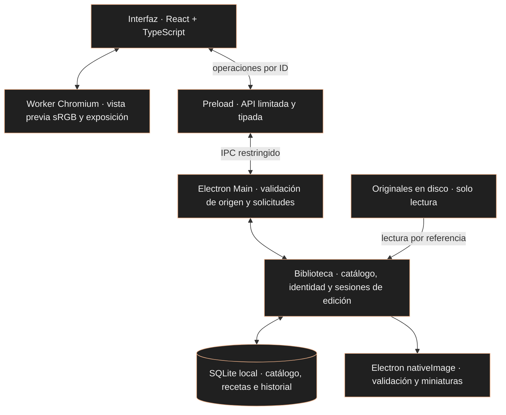

# Revelumo

[English](README.md) · [Português (Brasil)](README.pt-BR.md) · **Español**


<sub>Portada conceptual con imágenes de demostración generadas. No es una captura de la aplicación.</sub>

### Tus fotografías. En tu ordenador.

Un editor fotográfico de escritorio independiente para aficionados y entusiastas. Una biblioteca local para organizar tus fotos y empezar a revelar archivos JPEG, conservando los originales.

**Local · Sin suscripción · Sin funciones de IA en el producto**

[](https://github.com/glaucia86/revelumo/actions/workflows/ci.yml)


[Interfaz](#interface) · [Funciones actuales](#status) · [Pruébalo](#instalacao) · [Desarrollo](#desenvolvimento) · [Arquitectura](#arquitetura) · [Hoja de ruta](#roadmap)

> **Versión preliminar de desarrollo.** Revelumo ya tiene una interfaz de escritorio funcional: biblioteca, valoraciones, filtros y edición de exposición con historial persistente. Todavía no hay una versión publicada ni un instalador para el público. Para probarlo, es necesario ejecutar el proyecto desde el código fuente. El MVP y la validación multiplataforma siguen en desarrollo.

<a id="visao"></a>
## La fotografía se queda contigo

- **Biblioteca local.** El catálogo y los ajustes permanecen en tu ordenador, sin procesamiento de fotos ni sincronización en la nube.
- **Originales conservados.** La importación registra una referencia al archivo. La aplicación no mueve ni sobrescribe la fotografía.
- **Edición no destructiva.** La exposición se almacena como una receta independiente y se aplica a la vista previa.
- **Desarrollo independiente.** El coste cero y la ausencia de suscripción orientan el proyecto. El repositorio es público; su licencia todavía no se ha elegido.

Lightroom Classic es una referencia funcional para el flujo de biblioteca y edición. Revelumo tiene identidad propia, sin relación con Adobe ni promesa de ofrecer las mismas funciones.

<a id="interface"></a>
## Una interfaz que ya funciona

La aplicación abre una ventana de Electron con una interfaz React. Puedes importar archivos JPEG, explorar miniaturas, valorar fotos y filtrar la biblioteca. Al abrir una foto, puedes ajustar la exposición, compararla con 0 EV y deshacer o rehacer ajustes.

### La biblioteca en funcionamiento


<sub>Captura real de la etapa de importación JPEG por lotes en Linux, con imágenes sintéticas de prueba. Es anterior a los controles actuales de valoración, filtros y edición. [Informe de esta etapa](evidence/batch-jpeg/report.md).</sub>

<details>
<summary>Ver la vista previa de una foto de la misma etapa</summary>


La captura documenta la navegación entre la cuadrícula y la vista previa antes de incorporar el editor de exposición. Los controles actuales y sus verificaciones se describen en los informes de [exposición](evidence/issue-12/report.md) e [historial persistente](evidence/issue-16/report.md).

</details>

**Dirección visual elegida: A · Cobre.** Se ha elegido un entorno oscuro neutro, con detalles en cobre en los controles y las selecciones, para el rediseño. La aprobación corresponde a la dirección visual; el prototipo todavía no se ha integrado en la aplicación. Las capturas anteriores documentan la implementación existente.

**Idiomas:** la interfaz actual de la aplicación está en portugués. Este README está disponible en inglés, portugués de Brasil y español; la selección de idioma dentro de la aplicación está planificada y todavía no está disponible.

<a id="status"></a>
## Qué puedes hacer hoy

| Función | Disponible en la implementación actual |
| :--- | :--- |
| Importar archivos JPEG | Selección múltiple por referencia, progreso y errores por archivo; volver a importar la misma ruta canónica reutiliza la entrada del catálogo |
| Explorar la biblioteca | Cuadrícula de miniaturas derivadas, 48 fotos por página y vista previa de la foto seleccionada |
| Valorar fotos | De 1 a 5 estrellas o sin valoración; estados seleccionada, rechazada y sin marca |
| Filtrar la biblioteca | Valoración mínima o sin valoración, combinada con una marca; los filtros se conservan al volver de la vista previa durante la sesión |
| Localizar originales | Aviso de archivo ausente y relocalización individual por identidad SHA-256, conservando el ID, la valoración y los ajustes |
| Ajustar la exposición | De −3 a +3 EV en pasos de 0,1 EV, con ganancia en RGB lineal; comparación con 0 EV y restablecimiento |
| Guardar ajustes | Receta en SQLite, guardado automático y confirmación antes de salir del editor o cerrar normalmente |
| Deshacer y rehacer | Historial de exposición persistente con los últimos 100 pasos por foto, sin caducidad temporal |

### Un flujo para probar

1. Pulsa **Importar JPEGs** (Importar archivos JPEG) y selecciona fotografías en tu ordenador.
2. Abre una miniatura, asigna estrellas o una marca y vuelve a la cuadrícula para filtrar la biblioteca.
3. Abre una foto y ajusta **Exposição** (Exposición) con el control deslizante o el campo numérico.
4. Prueba **Comparar com 0 EV** (Comparar con 0 EV), **Redefinir exposição** (Restablecer exposición), **Desfazer exposição** (Deshacer exposición) y **Refazer exposição** (Rehacer exposición).
5. Espera la confirmación de guardado. Cierra y vuelve a abrir la aplicación para continuar con el catálogo, la receta y el historial guardados.

Un arrastre completo o una edición numérica finalizada representa un paso del historial, aunque el guardado automático se ejecute durante una pausa. Un nuevo ajuste después de deshacer elimina la posibilidad de rehacer los pasos anteriores. Al superar 100 pasos, los más antiguos dejan de estar disponibles. El historial actual solo cubre la exposición. [Comportamiento y límites](docs-agents/issue-16-contract.md).

### Límites importantes

- **JPEG en esta etapa:** hasta 32 MiB y 40 megapíxeles por archivo, dentro de los tipos aceptados por la validación inicial. RAW y HEIC todavía no son compatibles.
- **Vista previa de edición:** derivada en sRGB, con hasta 2048 px en el lado más largo. No es una exportación a resolución original; la gama de color, el recorte de valores y la cuantización limitan la vista previa.
- **Color y orientación:** se han verificado imágenes sintéticas sRGB/Display-P3 y orientaciones EXIF 1–8 en Electron. La compatibilidad amplia con cámaras, perfiles ICC y flujos profesionales todavía debe evaluarse.
- **Persistencia:** tras una interrupción, se recupera el último estado realmente guardado. Los cambios posteriores aún no guardados pueden perderse.
- **Originales:** el catálogo no es una copia de seguridad. Conserva tus propias copias de las fotos y del catálogo.
- **Todavía en desarrollo:** balance de blancos, recorte y exportación JPEG. Estas funciones no están disponibles en la versión integrada descrita aquí.

<details>
<summary>Cómo funciona la relocalización de un original</summary>

La miniatura permanece en el catálogo cuando el original cambia de ubicación. La cuadrícula comprueba la disponibilidad al cargar una página, volver a la aplicación o pulsar **Verificar disponibilidade** (Comprobar disponibilidad), sin leer ni calcular el hash de todos los originales. La presencia del archivo no demuestra su integridad; la foto seleccionada recibe la comprobación completa.

**Localizar original** acepta un archivo cada vez y exige exactamente los mismos bytes, verificados mediante SHA-256. Se conservan el ID, el nombre del catálogo y los datos asociados. Volver a importar contenido diferente en la misma ruta no sustituye silenciosamente la identidad registrada.

Una entrada antigua sin identificación cuyo original ya esté ausente no puede volver a vincularse de forma segura. En ese caso, puedes importar el archivo como una nueva entrada y conservar la anterior. [Política de identidad](docs-agents/adr/0003-original-identity-relocation.md) · [Verificaciones de relocalización](evidence/relocation-windows/report.md).

</details>

<a id="instalacao"></a>
## Cómo probarlo

**Todavía no hay un instalador `.exe`, una imagen `.dmg` ni un paquete Linux publicados como versión para el público.** Los siguientes comandos preparan una copia de desarrollo en tu ordenador. El empaquetado genera una carpeta de aplicación; no instala Revelumo en el sistema.

### Requisitos previos

- [Git](https://git-scm.com/downloads).
- [Node.js 24](https://nodejs.org/en/download), con npm. Es la versión utilizada por CI.
- Conexión a Internet para descargar el código, las dependencias y el binario oficial de Electron.
- Una sesión gráfica para abrir la aplicación. En Linux también se necesitan las bibliotecas de sistema que Electron requiere en tu distribución.

Comprueba en el terminal:

```sh
git --version
node --version
npm --version
```

No necesitas instalar un servidor SQLite aparte: el catálogo usa el SQLite incluido en el entorno de ejecución Node/Electron. Consulta los [requisitos de desarrollo de Electron](https://www.electronjs.org/docs/latest/tutorial/tutorial-prerequisites).

### Preparar el código fuente

En **PowerShell o Símbolo del sistema en Windows**, **Terminal en macOS** o un **terminal de Linux**, ejecuta:

```sh
git clone https://github.com/glaucia86/revelumo.git
cd revelumo
npm ci
npm run install:electron
npm run typecheck
npm test
```

`npm ci` utiliza el archivo de bloqueo del repositorio. `install:electron` descarga el binario oficial necesario para esta versión de Electron, que no lo instala automáticamente junto con el paquete npm. Si un comando falla, resuelve el error antes de continuar.

### Abrirlo en tu sistema

| Sistema | Entorno de desarrollo | Qué se ha verificado |
| :--- | :--- | :--- |
| Windows | PowerShell o Símbolo del sistema; utiliza los comandos comunes de esta sección | Paquete x64, pruebas e integración automatizada de Electron; inspección visual y diálogo nativo de Windows aún pendientes |
| macOS | Terminal; los mismos comandos son el punto de partida | Todavía no validado en macOS, Intel ni Apple Silicon; no se garantiza la ejecución en esta etapa |
| Linux | Terminal en una sesión gráfica; utiliza los comandos comunes | Paquete x64 abierto y flujos inspeccionados visualmente en un entorno Linux; esto no establece compatibilidad con todas las distribuciones |

Para iniciar el modo de desarrollo:

```sh
npm start
```

Este comando está configurado en el proyecto, pero su flujo completo todavía no se ha validado de extremo a extremo. Las pruebas existentes se centran en la aplicación empaquetada.

Como alternativa, genera el paquete local en tu propio sistema:

```sh
npm run package
```

El resultado queda en `out/`. En los destinos x64 ya empaquetados, el ejecutable está en:

- **Windows:** `out/Revelumo-win32-x64/Revelumo.exe`.
- **Linux:** `out/Revelumo-linux-x64/Revelumo`.
- **macOS:** el resultado `.app` todavía debe generarse y validarse para este proyecto.

El ejecutable de Windows en esta carpeta es un paquete de desarrollo, no un instalador. Mantén juntos los archivos de la carpeta. La configuración actual usa `makers: []`: `npm run make` todavía no es un flujo preparado para generar instaladores. [Diferencia entre package y make en Forge](https://www.electronforge.io/cli).

> Todavía no se han establecido las versiones mínimas de los sistemas, las arquitecturas compatibles ni los requisitos de memoria. Un ordenador con 8 GB de RAM y sin GPU dedicada es un objetivo de prueba, no un requisito mínimo demostrado. No desactives las protecciones del sistema para intentar abrir una compilación.

<a id="desenvolvimento"></a>
## Desarrollo y verificación

### Comandos principales

| Comando | Finalidad |
| :--- | :--- |
| `npm run typecheck` | Validar los tipos de TypeScript |
| `npm test` | Ejecutar la suite del núcleo con Node, sistema de archivos y SQLite reales |
| `npm start` | Abrir el modo de desarrollo de Electron Forge |
| `npm run package` | Generar la aplicación local en `out/`, sin instalador |

Para ejecutar solo las pruebas del núcleo con Node.js 24, no necesitas instalar las dependencias:

```sh
node --test test/*.test.ts
```

La eliminación de tipos que realiza Node no sustituye la comprobación de tipos. Las pruebas del núcleo utilizan un sustituto del decodificador; la integración con el decodificador, worker, canvas, IPC y renderer reales se comprueba en las pruebas de Electron empaquetado.

### CI y evidencias

El [flujo de CI](.github/workflows/ci.yml) verifica PRs, pushes a `main` y ejecuciones manuales en **Windows y Ubuntu**, con Node 24, instalación desde el archivo de bloqueo, comprobación de tipos, pruebas y empaquetado. Windows también ejecuta escenarios de importación, relocalización, filtros, exposición e historial en Electron empaquetado, incluida la reapertura en procesos independientes.

- [Ejecuciones actuales en GitHub Actions](https://github.com/glaucia86/revelumo/actions/workflows/ci.yml)
- [Reproducción de CI y límites por sistema](docs-agents/ci.md)
- [Importación por lotes, cuadrícula e interrupción en Linux](evidence/batch-jpeg/report.md)
- [Valoración y filtros en Windows](evidence/filters-windows/report.md)
- [Exposición, guardado automático, color y mediciones de recursos](evidence/issue-12/report.md)
- [Historial persistente, retención y QA visual en Linux](evidence/issue-16/report.md)

Los informes registran la revisión y el entorno de cada etapa; sus referencias a publicación o CI pendientes son históricas. Consulta los PRs y Actions para conocer el estado remoto. Las pruebas automatizadas usan imágenes sintéticas y sustituyen el diálogo nativo en el punto de selección de archivos. No demuestran una validación con fotografías reales, lectores de pantalla, equipos de 8 GB ni macOS. La mayoría de los informes técnicos detallados están actualmente en portugués.

CI conserva los resultados en los registros y resúmenes de los jobs, sin subir paquetes ni mantener cachés persistentes. La matriz de CI no es una declaración de soporte para usuarios finales.

<a id="arquitetura"></a>
## Arquitectura local



- **Interfaz:** biblioteca, filtros, valoraciones y controles de edición. El renderer no recibe rutas de originales ni acceso directo a Node, archivos o SQLite.
- **Preload y main:** la [API tipada](src/shared/contracts.ts) y la [validación de solicitudes](src/shared/requests.ts) restringen las operaciones. Los diálogos y el acceso a archivos pertenecen al proceso main; la ventana conserva el aislamiento de contexto, el sandbox y la integración de Node desactivada en el renderer.
- **Catálogo:** `app.getPath('userData')/catalog.sqlite` almacena referencias, identidad, miniaturas, valoraciones, recetas e historial. El esquema actual es **v6**, con migración transaccional desde v5; las versiones anteriores que no conocen el nuevo esquema rechazan la base de datos sin borrarla.
- **Edición:** la API entrega el JPEG original para preparar la vista previa; el worker deriva una imagen sRGB reducida y aplica la exposición en RGB lineal. El historial almacena valores y metadatos, sin una imagen por paso. La receta, el cursor y el punto de control se guardan de forma transaccional.

**Tecnologías utilizadas:** Electron, React, TypeScript, Vite/Electron Forge y SQLite. No hay código Rust integrado ni es necesario instalar Rust para esta versión.

**Decisiones abiertas:** motor RAW, posible worker nativo en Rust o C++ y licencia del producto. RawTherapee se evaluó en un [experimento inicial en Windows](evidence/rawtherapee-cli-windows/report.md); esa investigación no seleccionó el motor ni aprobó su adopción como dependencia.

[Catálogo e IPC](docs-agents/adr/0001-local-catalog-ipc.md) · [Lotes y miniaturas](docs-agents/adr/0002-batch-jpeg-thumbnails.md) · [Exposición y guardado automático](docs-agents/adr/0004-jpeg-exposure-autosave.md) · [Historial persistente](docs-agents/issue-16-contract.md)

<a id="roadmap"></a>
## El camino hacia el primer MVP

| Etapa | Estado |
| :--- | :--- |
| Biblioteca JPEG local | Importación, cuadrícula, miniaturas, persistencia y relocalización implementadas |
| Organización | Estrellas, marcas y filtros implementados |
| Primeras herramientas de edición no destructiva | Exposición, guardado automático e historial persistente de 100 pasos implementados |
| Balance de blancos y recorte | En desarrollo; todavía no disponibles en la versión integrada |
| Exportación JPEG | En desarrollo; todavía no se generan nuevos archivos de salida |
| Rediseño visual | Dirección A · Cobre elegida; implementación pendiente |
| Idiomas de la aplicación: portugués, inglés y español | Planificados; selección de idioma todavía no implementada |
| RAW, lectura HEIC, exportación TIFF y ajustes por lotes | Planificados; dependen de nuevas decisiones y validaciones |
| Distribución | Instaladores, versiones publicadas y validación ampliada por sistema todavía pendientes |

HDR y exportación HEIC quedan fuera del primer MVP. La hoja de ruta indica una dirección, sin fechas de entrega prometidas.

## Sigue el proyecto

Las decisiones, dependencias y tareas en curso se organizan en [GitHub Issues](https://github.com/glaucia86/revelumo/issues) y [pull requests](https://github.com/glaucia86/revelumo/pulls). Las condiciones para las contribuciones públicas todavía deben definirse.

**Licencia:** pendiente de elección. La visibilidad pública del repositorio no concede una licencia de código abierto.

---

## Creadora

<p align="center">
  <a href="https://github.com/glaucia86"></a>
</p>

### Glaucia Lemos

Principal Software Engineer, ex-Microsoft, Microsoft MVP y Codex Ambassador. Crea contenido técnico, imparte charlas y realiza sesiones de programación en directo sobre JavaScript, TypeScript y desarrollo de software. Es la creadora de Revelumo.

[GitHub](https://github.com/glaucia86) · [LinkedIn](https://www.linkedin.com/in/glaucialemos/) · [X / Twitter](https://twitter.com/glaucia_lemos86) · [YouTube](https://www.youtube.com/user/l32759) · [Twitch](https://www.twitch.tv/glaucia_lemos86) · [Más enlaces](https://linktr.ee/glaucia_lemos86)

---

**Revelumo · La fotografía, en primer lugar.**
