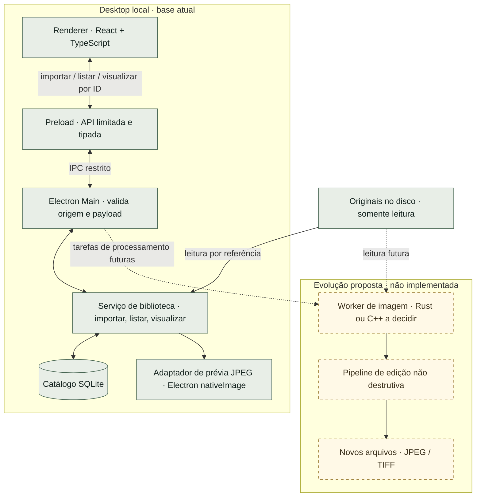

# Revelumo


<sub>Capa conceitual com imagens demonstrativas geradas. Não é uma captura de tela do aplicativo.</sub>

### Suas fotografias. No seu computador.

Um espaço para organizar, revelar e dar forma às suas fotografias.

Editor fotográfico desktop independente, pensado para amadores e entusiastas.
Local, sem assinatura e sem funcionalidades de IA no produto.


[Visão](#visao) · [Status](#status) · [Arquitetura](#arquitetura) · [Instalação](#instalacao) · [Desenvolvimento](#desenvolvimento) · [Roadmap](#roadmap)

---

> **Prévia de desenvolvimento.** A primeira fatia JPEG foi validada de ponta a ponta no pacote Linux x64 deste ambiente de teste. Ainda não há release nem instaladores; Windows e macOS não foram validados. As seções abaixo distinguem o que existe hoje do que está planejado.

<a id="visao"></a>
## A fotografia fica com você

O Revelumo nasce para reunir biblioteca e edição em um fluxo desktop acessível, com processamento no próprio computador e originais preservados.

- **Local por princípio.** Catálogo no seu computador, sem processamento de fotos ou sincronização em nuvem.
- **Originais preservados.** A importação atual registra uma referência ao arquivo, sem mover ou regravar a fotografia.
- **Um fluxo completo como destino.** Organizar, selecionar, editar e exportar fazem parte do plano; a primeira etapa começa no catálogo JPEG.
- **Construção independente.** Custo zero e ausência de assinatura orientam o projeto. O repositório é privado nesta fase; abertura do código e licença ainda precisam ser definidas.

A referência funcional é o fluxo de um editor como Lightroom Classic. O Revelumo tem identidade própria, sem vínculo com a Adobe ou promessa de paridade de recursos.

<a id="status"></a>
## Onde estamos

| Área | Estado atual |
| :--- | :--- |
| Catálogo SQLite | Testado em Node e no aplicativo Linux; referências persistem após encerrar e reabrir |
| Importação JPEG | Um arquivo por operação, por referência; mesmo caminho canônico reaproveita o registro |
| Prévia | Bytes JPEG, EXIF e ICC preservados; exibição e orientação EXIF 6/8 verificadas com fixtures sintéticas no Electron Linux |
| Interface desktop | Aplicativo empacotado e executado no desktop Linux cloud; importação, prévia e reabertura verificadas |
| Edição e exportação | Planejadas, ainda não implementadas |
| Distribuição | Pacote de desenvolvimento Linux x64 testado; sem instaladores ou releases; Windows/macOS pendentes |

**Evidência disponível:** 25 testes do núcleo passaram em Node, o typecheck TypeScript passou e o Forge gerou o pacote Linux. No aplicativo real foram verificados cancelamento, importação, reimportação sem duplicata, rejeição de JPEG inválido, original ausente e reabertura após encerrar o processo. Os hashes das fixtures permaneceram iguais. [Relatório e capturas do teste Linux](evidence/e2e-linux/report.md).

Nesta fatia, cada JPEG pode ter até **32 MiB e 40 megapixels**, dentro dos tipos de frame aceitos pelo preflight. Orientações EXIF 6 e 8 foram verificadas em imagens sintéticas; fidelidade de cor e compatibilidade ampla ainda precisam de avaliação. Arquivos ausentes permanecem no catálogo e retornam erro ao abrir a prévia; relocalização vem depois.

<a id="arquitetura"></a>
## Arquitetura

**Uma aplicação desktop. Uma biblioteca local. Limites claros entre interface e arquivos.**

O diagrama mostra a base escrita hoje e a evolução proposta. Os componentes Electron/React foram validados no fluxo JPEG do pacote Linux de desenvolvimento. As conexões tracejadas representam trabalho futuro.



### As fronteiras de hoje

- **Renderer:** apresenta a biblioteca e a prévia. Não recebe caminhos dos originais nem acesso direto a Node, filesystem ou SQLite.
- **Preload:** expõe somente `importJpeg`, `listPhotos` e `previewPhoto` pelo `contextBridge`.
- **Main:** controla o diálogo nativo, valida as requisições e concentra o acesso ao catálogo e aos arquivos. A janela usa isolamento de contexto, sandbox e Node desabilitado no renderer.
- **SQLite:** guarda o catálogo em `app.getPath('userData')/catalog.sqlite`. Fotos continuam no local original; o catálogo não é uma cópia de segurança delas.
- **Prévia atual:** usa o JPEG original em memória, sem re-encode ou redução de resolução. Cache de miniaturas e processamento em worker ficam para as próximas etapas.

**Decisões abertas:** o worker nativo poderá ser em Rust ou C++; o motor RAW ainda não foi escolhido. O motor do RawTherapee é um candidato a investigar, sujeito a avaliação técnica e de licença. Essas opções não são dependências da primeira fatia.

Veja a [decisão de catálogo e IPC](docs-agents/adr/0001-local-catalog-ipc.md) e o [estado técnico com evidências](docs-agents/implementation-status.md).

<a id="instalacao"></a>
## Instalação por sistema operacional

**Ainda não há arquivos para baixar.** Os passos abaixo descrevem a experiência de distribuição pretendida, quando houver uma release validada no [repositório oficial](https://github.com/glaucia86/revelumo). O acesso depende das permissões enquanto ele for privado.

### Windows

Formato pretendido: **instalador `.exe`**.

1. Baixar o instalador compatível com seu sistema a partir da release oficial.
2. Executar o instalador e seguir suas instruções.
3. Abrir o Revelumo pelo menu Iniciar.

Assinatura digital e experiência com o SmartScreen ainda precisam ser definidas e testadas. Caso o Windows apresente um aviso de segurança, confira a origem e as instruções daquela release antes de continuar.

### macOS

Formato pretendido: **imagem `.dmg`**.

1. Baixar a imagem compatível com seu Mac a partir da release oficial.
2. Abrir o `.dmg` e arrastar o Revelumo para Aplicativos.
3. Abrir o aplicativo pela pasta Aplicativos.

A abordagem inicial aprovada é distribuir o `.dmg` sem contratar assinatura ou notarização pagas. Compatibilidade com Apple Silicon e Intel, abertura do aplicativo e avisos do macOS ainda precisam ser testados e documentados. As instruções de instalação deverão preservar as proteções do sistema.

### Linux

**Formato de distribuição a definir.** AppImage, `.deb` e `.rpm` são possibilidades de empacotamento, sem escolha ou suporte confirmados.

Quando houver uma release, ela deverá informar as distribuições e arquiteturas testadas, as dependências necessárias e o procedimento exato de instalação. O pacote local Linux x64 foi aberto e testado, mas ainda não há instalador ou comando público de instalação validado.

> **Requisitos:** versões mínimas dos sistemas e arquiteturas suportadas ainda não foram estabelecidas. Um computador com 8 GB de RAM e sem GPU dedicada é um alvo de teste, não um requisito mínimo comprovado.

<a id="desenvolvimento"></a>
## Desenvolvimento local

### Testar o núcleo agora

Com **Node.js 24** e esta árvore de código disponível localmente, execute na raiz:

```sh
node --test test/*.test.ts
```

Esse caminho não exige instalar dependências do projeto. Os testes do núcleo não incluem o decodificador Electron real. A execução TypeScript pelo Node remove os tipos, mas não substitui o typecheck.

### Preparar o aplicativo desktop

Dependências instaladas, typecheck, testes e empacotamento foram verificados neste ambiente. A execução gráfica foi feita pelo binário gerado em `out/Revelumo-linux-x64/Revelumo`; o modo de desenvolvimento `npm start` ainda não foi testado de ponta a ponta. Com o lockfile incluído:

```sh
npm ci
npm run install:electron
npm run typecheck
npm test
npm start
npm run package
```

O `package-lock.json` registra as versões instaladas. O comando `install:electron` baixa o binário oficial do Electron necessário para executar o aplicativo; esta versão não o instala automaticamente junto com o pacote npm. Se o cache padrão não for gravável, use um diretório de cache autorizado com `npm --cache <diretório>` e `electron_config_cache=<diretório>` para instalação/empacotamento. O Forge está sem makers configurados: `package` gera a pasta do aplicativo; **não há geração de instaladores pronta**.

O gate Linux da primeira fatia foi cumprido. Permanecem pendentes validação em Windows/macOS, o modo de desenvolvimento, distribuição e uma matriz maior de fotografias reais. O [checkpoint técnico](docs-agents/implementation-status.md) detalha resultados e limites.

<a id="roadmap"></a>
## O caminho até o primeiro MVP

| Etapa | Entrega pretendida | Situação |
| :--- | :--- | :--- |
| 01 · Encontrar suas fotos | Importação por referência, catálogo e prévia JPEG; reencontrar fotos ao reabrir | Validada no fluxo Linux x64 |
| 02 · Organizar o olhar | Grade, relocalização de arquivos e classificação por estrelas | Planejada |
| 03 · Revelar | Edição não destrutiva e cópia de ajustes em lote | Planejada |
| 04 · Compartilhar | Exportação de novos arquivos JPEG e TIFF | Planejada |

RAW e leitura HEIC dependem de uma matriz de compatibilidade e da validação do motor de imagem. HDR e exportação HEIC ficam para depois do MVP. O roadmap indica direção, sem datas de entrega prometidas.

## Acompanhe a construção

Decisões e trabalho do projeto serão organizados em [GitHub Issues](https://github.com/glaucia86/revelumo/issues), com acesso restrito nesta fase. O mapa de trabalho e os tickets ainda não foram publicados. A abertura do repositório e as condições para contribuições públicas serão definidas antes dessa transição.

**Licença:** pendente de escolha. Ainda não há licença open source concedida pelo projeto.

---

<div align="center">

Criado por **[Glaucia Lemos](https://github.com/glaucia86)** · Principal Software Engineer · Codex Ambassador

**Revelumo · Fotografia em primeiro lugar.**

</div>
