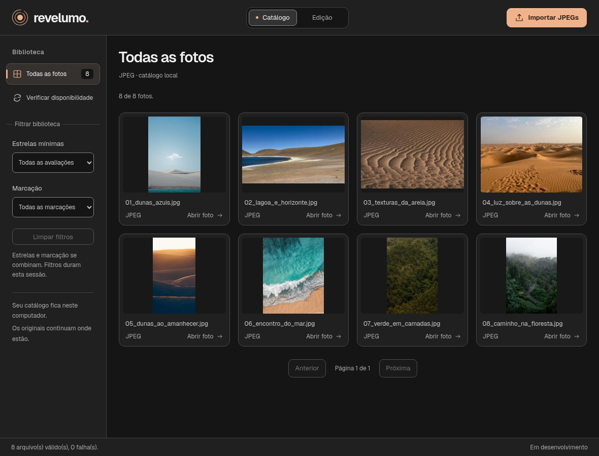
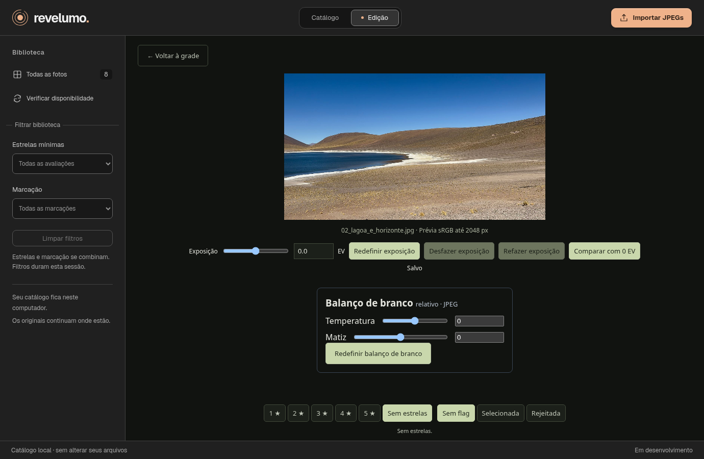
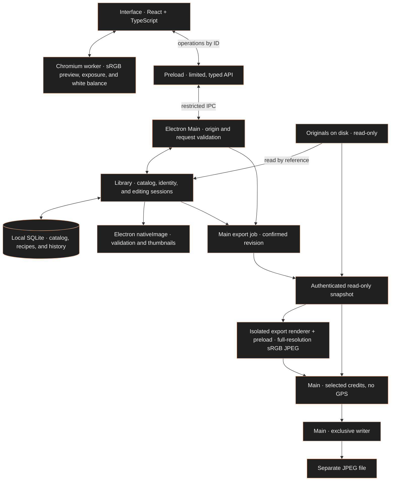

<a id="topo"></a>
<div align="center">

<h1>Revelumo</h1>
<p><strong>English</strong> · <a href="README.pt-BR.md">Português (Brasil)</a> · <a href="README.es.md">Español</a></p>
<p><strong>Your photographs. On your computer.</strong></p>
<p>An independent desktop photo editor for hobbyists and enthusiasts.<br>A local library to organize and edit JPEGs while preserving the originals.</p>
<p><strong>Local · No subscription · No AI features in the product</strong></p>


<p><sub>Real Cobre catalog in the packaged Linux app, with JPEGs imported through the application. Development build, not a public installer. <a href="docs/assets/screenshots/README.md">Capture details and photo credits</a>.</sub></p>

<p>
<a href="https://github.com/glaucia86/revelumo/actions/workflows/ci.yml"></a>
<a href="LICENSE"></a>


</p>
</div>

---

## Contents

- [Vision](#visao)
- [Working interface](#interface)
- [Current features and limits](#status)
- [Try the application](#instalacao)
- [Development and checks](#desenvolvimento)
- [Architecture and Rust](#arquitetura)
- [Roadmap](#roadmap)
- [Contributing](#contributing)
- [Support and security](#support)
- [License and third parties](#license)
- [About the creator](#creator)

> **Development preview.** Revelumo already has a working desktop interface: a library, ratings, filters, exposure editing with persistent history, and relative white balance. The experimental [0.1.0-alpha.1 source pre-release](https://github.com/glaucia86/revelumo/releases/tag/v0.1.0-alpha.1) is available; there are no public installers. To try it, you need to run the project from source. The MVP and cross-platform validation are still in progress.

<a id="visao"></a>
## Your photography stays with you

- **Local library.** Your catalog and adjustments stay on your computer, without cloud photo processing or synchronization.
- **Preserved originals.** Importing records a reference to the file. The application does not move or overwrite the photograph.
- **Non-destructive editing.** Exposure and relative white balance are stored as a separate recipe and applied to the preview.
- **Independent development.** Zero cost and no subscription guide the project. Original code and written documentation are available under MIT, with third-party rights preserved.

Lightroom Classic is a functional reference for the library and editing workflow. Revelumo has its own identity, with no Adobe affiliation or promise of feature parity.

<a id="interface"></a>
## A working desktop interface

The application opens an Electron window with a React interface. You can import JPEGs, browse thumbnails, rate photos, and filter the library. Opening a photo lets you adjust exposure and relative white balance, compare with 0 EV while keeping white balance, and undo or redo exposure changes.

### The current catalog

The main image above shows the implemented **A · Cobre (Copper)** catalog: a neutral dark workspace, copper accents, local JPEGs, and library filters. The images were actually imported into the packaged application. [Implementation and verification](evidence/cobre-catalog/report.md).

### Editing a photo



The editor already supports exposure, relative white balance, autosave, and exposure history. This is its current working interface; the editor's full Cobre redesign remains planned. [Capture details and photo credits](docs/assets/screenshots/README.md).

**Languages:** the catalog, import flow, application shell and existing editor support Brazilian Portuguese, English and Spanish through a persistent language selector. This includes exposure, relative white balance, history, comparison, rating/flags, relocation and recovery messages. The first launch follows the system languages, falling back to English. JPEG export is also translated; crop remains pending.

<a id="status"></a>
## What you can do today

| Feature | Available in the current implementation |
| :--- | :--- |
| Import JPEGs | Multiple files imported by reference, per-file progress and errors; importing the same canonical path again reuses the catalog entry |
| Browse the library | Derived thumbnail grid, 48 photos per page, and a preview of the selected photo |
| Rate photos | 1–5 stars or unrated; selected, rejected, and unflagged states |
| Filter the library | Minimum star rating or unrated, combined with a flag; filters are retained when returning from the preview within the session |
| Locate missing originals | Missing-file notices and individual relocation by SHA-256 identity, preserving the photo ID, rating, and adjustments |
| Adjust exposure | −3 to +3 EV in 0.1 EV steps, with gain in linear RGB; comparison with 0 EV and reset |
| Adjust white balance | Relative temperature and tint from −100 to +100, in integer steps; reset both without changing exposure |
| Save adjustments | A recipe in SQLite, autosave, and confirmation before leaving the editor or closing normally |
| Undo and redo | Persistent exposure history retaining the latest 100 steps per photo, without time-based expiration |

### A workflow to try

1. Click **Importar JPEGs** (Import JPEGs) and select photographs on your computer.
2. Open a thumbnail, assign stars or a flag, and return to the grid to filter the library.
3. Open a photo and adjust **Exposição** (Exposure) with the slider or numeric field.
4. Adjust **Temperatura** (Temperature) and **Matiz** (Tint), or use **Redefinir balanço de branco** (Reset white balance). These are relative controls, not Kelvin.
5. Try **Comparar com 0 EV** (Compare with 0 EV), **Redefinir exposição** (Reset exposure), **Desfazer exposição** (Undo exposure), and **Refazer exposição** (Redo exposure).
6. Wait for the saved confirmation. Close and reopen the app to continue with the persisted catalog, recipe, and history.

A complete drag or completed numeric edit counts as one history step, even if autosave runs during a pause. A new adjustment after undoing discards the redo path. Beyond 100 steps, the oldest steps are no longer available. The current history covers exposure only. Changing white balance does not create an exposure-history step or discard its redo path; undoing exposure preserves white balance. [Behavior and limits](docs-agents/issue-16-contract.md).

### Important limits

- **JPEG at this stage:** up to 32 MiB and 40 megapixels per file, within the frame types accepted by the initial validation. RAW and HEIC are not supported yet.
- **Editing preview:** an sRGB derivative, up to 2048 px on its longest side. This is not a full-resolution export; gamut, clipping, and quantization limit the preview.
- **Color and orientation:** synthetic sRGB/Display-P3 fixtures and EXIF orientations 1–8 have been verified in Electron. Broad compatibility with cameras, ICC profiles, and professional workflows still needs evaluation.
- **Persistence:** an interruption recovers the last state actually saved. Later changes that have not been persisted may be lost.
- **Originals:** the catalog is not a backup. Keep your own backups of the photos and catalog.
- **Relative white balance:** an adjustment to an already-rendered JPEG, not a camera temperature or RAW development. There is no eyedropper, preset, or automatic white balance. [Behavior and validation](docs-agents/adr/0005-jpeg-white-balance.md).
- **JPEG export:** use **Export JPEG** in the editor. It confirms the current adjustments, then asks for a new local filename. One original-resolution, Chromium quality-0.90 sRGB JPEG is created with exposure/white balance and orientation applied. Selected authorship/copyright is preserved and GPS metadata removed. Existing files and originals are never replaced. This version limits output to 32 MiB and refuses larger results without lowering quality or resolution. “Quality 90” means the Chromium encoder’s fixed 0.90 parameter; it does not guarantee equivalent quality or chroma subsampling across encoders.
- **Still in development:** cropping. Unknown recipes, including crop, are rejected rather than silently exported without their adjustments.

<details>
<summary>How locating a missing original works</summary>

The thumbnail remains in the catalog when the original moves. The grid checks availability when loading a page, returning to the app, or clicking **Verificar disponibilidade** (Check availability), without reading or hashing every original. File presence does not prove integrity; the selected photo receives the full check.

**Localizar original** (Locate original) accepts one file at a time and requires exactly the same bytes, verified by SHA-256. The ID, cataloged name, and associated data are preserved. Reimporting different content at the same path does not silently replace the recorded identity.

An older entry without an identity whose original is already missing cannot be safely relinked. In that case, you can import the file as a new entry and keep the old one. [Identity policy](docs-agents/adr/0003-original-identity-relocation.md) · [Relocation checks](evidence/relocation-windows/report.md).

</details>

<a id="instalacao"></a>
## How to try it

**There is no `.exe` installer, `.dmg` image, or Linux package published as a release yet.** The commands below prepare a development copy on your computer. Packaging generates an application folder; it does not install Revelumo on the system.

### Prerequisites

- [Git](https://git-scm.com/downloads).
- [Node.js 24](https://nodejs.org/en/download), with npm. This is the version used by CI.
- Internet access to download the source, dependencies, and official Electron binary.
- A graphical session to open the application. Linux also needs the system libraries required by Electron for your distribution.

Check your terminal:

```sh
git --version
node --version
npm --version
```

You do not need a separate SQLite server: the catalog uses SQLite provided by the Node/Electron runtime. See the framework's [development prerequisites](https://www.electronjs.org/docs/latest/tutorial/tutorial-prerequisites).

### Prepare the source

In **PowerShell or Command Prompt on Windows**, **Terminal on macOS**, or a **Linux terminal**, run:

```sh
git clone https://github.com/glaucia86/revelumo.git
cd revelumo
npm ci
npm run install:electron
npm run typecheck
npm test
```

`npm ci` uses the repository's lockfile. `install:electron` downloads the official binary required by this Electron version, which does not automatically install it with the npm package. If a command fails, resolve that failure before continuing.

### Open it on your system

| System | Development path | What has been verified |
| :--- | :--- | :--- |
| Windows | PowerShell or Command Prompt; use the common commands above and below | x64 package, tests, and automated Electron integration; visual inspection and the native Windows dialog are still pending |
| macOS | Terminal; the same commands are the starting point | Not yet validated on macOS, Intel, or Apple Silicon; execution is not guaranteed at this stage |
| Linux | Terminal in a graphical session; use the common commands | x64 package launched and workflows visually inspected in one Linux environment; this does not establish support for every distribution |

To start development mode:

```sh
npm start
```

This command is configured in the project, but its complete workflow has not yet been validated end to end. Existing evidence focuses on the packaged application.

Alternatively, build a local package on your own system:

```sh
npm run package
```

The output is in `out/`. For the x64 targets already packaged, the executable is located at:

- **Windows:** `out/Revelumo-win32-x64/Revelumo.exe`.
- **Linux:** `out/Revelumo-linux-x64/Revelumo`.
- **macOS:** the `.app` output still needs to be produced and validated for this project.

The Windows executable in this folder is a development package, not an installer. Keep the folder's files together. The configuration currently uses `makers: []`: `npm run make` is not a ready-to-use installer-generation workflow. [Package versus make in Forge](https://www.electronforge.io/cli).

> Minimum OS versions, supported architectures, and memory requirements have not been established. A computer with 8 GB RAM and no dedicated GPU is a test target, not a proven minimum requirement. Do not disable system protections to try opening a build.

<a id="desenvolvimento"></a>
## Development and verification

### Main commands

| Command | Purpose |
| :--- | :--- |
| `npm run check:docs` | Check local documentation links and language navigation |
| `npm run typecheck` | Check TypeScript types |
| `npm test` | Run the core suite with real Node, filesystem, and SQLite |
| `npm start` | Open Electron Forge development mode |
| `npm run package` | Generate the local application in `out/`, without an installer |

After `npm ci`, run only the core tests with Node.js 24 (Electron is not required):

```sh
node --test test/*.test.ts
```

Node's type stripping does not replace typechecking. Core tests substitute the decoder; integration with the real decoder, worker, canvas, IPC, and renderer is exercised by the packaged Electron tests.

### CI and evidence

The [CI workflow](.github/workflows/ci.yml) checks PRs, pushes to `main`, and manual runs on **Windows and Ubuntu**, using Node 24, offline documentation checks, lockfile installation, typechecking, tests, and packaging. Windows also runs import, relocation, filtering, exposure, history, and white-balance scenarios in the packaged Electron app, including reopening in separate processes. Windows additionally gates the isolated JPEG engine, full export circuit and editor export UI, including cancellation and IPC recovery.

- [Current GitHub Actions runs](https://github.com/glaucia86/revelumo/actions/workflows/ci.yml)
- [Reproducing CI and platform-specific limits](docs-agents/ci.md)
- [Batch import, grid, and interruption on Linux](evidence/batch-jpeg/report.md)
- [Classification and filters on Windows](evidence/filters-windows/report.md)
- [Exposure, autosave, color, and resource measurements](evidence/issue-12/report.md)
- [Persistent history, retention, and Linux visual QA](evidence/issue-16/report.md)
- [Relative white balance, full-recipe persistence, and color checks](evidence/issue-17/report.md)
- [Cobre catalog, packaged interaction checks, and visual limits](evidence/cobre-catalog/report.md)
- [Isolated full-resolution engine and corpus](evidence/issue-19-engine/report.md)
- [Metadata, exclusive writer and resource measurements](evidence/issue-19-circuit/report.md)
- [Visible export UI and recovery checks](evidence/issue-19-ui/report.md)

Reports record each milestone's revision and environment; references to pending publication or CI in those records are historical. Consult PRs and Actions for the remote status. Automated regression tests use synthetic images and substitute the native dialog at the file-selection boundary. Licensed photographs were also imported for the UI captures; this limited visual check does not establish broad camera-file compatibility or validation with screen readers, 8 GB hardware, or macOS. Most detailed engineering reports are currently in Portuguese.

CI keeps results in logs and job summaries, without package uploads or persistent caches. The CI matrix is not an end-user support declaration.

<a id="arquitetura"></a>
## Local architecture



- **Interface:** library, filters, classification, and editing controls. The renderer receives neither original file paths nor direct access to Node, files, or SQLite.
- **Preload and main:** the [typed API](src/shared/contracts.ts) and [request validation](src/shared/requests.ts) restrict operations. Dialogs and file access belong to the main process; the window maintains context isolation, sandboxing, and disabled Node integration in the renderer.
- **Catalog:** `app.getPath('userData')/catalog.sqlite` stores references, identity, thumbnails, classification, recipes, and history. The current schema is **v7**, with a transactional migration from v6; older versions that do not recognize the new schema refuse the database without deleting it.
- **Editing:** the API delivers the original JPEG to prepare the preview; the worker derives a reduced sRGB image and composes exposure and relative white balance in linear RGB. History stores values and metadata, without an image per step. The recipe, cursor, and checkpoint are persisted transactionally.

- **Export:** The main-owned job authenticates one original, sends the verified bytes to the isolated engine, then adds selected credits and exclusively writes a separate JPEG. The export renderer has no Node or filesystem access. [Implemented flow and checks](evidence/issue-19-ui/report.md). The [request parser](src/shared/jpeg-export-request.ts) checks allowed keys, UUIDs and revision bounds. The [IPC handler](src/main/jpeg-export-ipc.ts) authenticates the owner/main frame and origin; the main generation token scopes jobs, and [Library.captureExport](src/main/library.ts) verifies the current editing session and confirmed revision. Paths remain main-owned inputs. Only the output receipt reveals the selected output path. See the [UI contract](docs-agents/jpeg-export-ui-design.md). Row-band processing does not bound total RAM: the engine still decodes a full-resolution raster. The [historical complete-circuit measurement](evidence/issue-19-circuit/report.md) documents one workload, not an 8 GB support guarantee.

**Implemented stack:** Electron, React, TypeScript, Vite/Electron Forge, and SQLite. No Rust code is integrated, and installing Rust is not required for this version.

**Open decisions:** the RAW engine and a possible native worker in Rust or C++. RawTherapee was evaluated in an [initial Windows experiment](evidence/rawtherapee-cli-windows/report.md); that investigation did not select the engine or approve it as a dependency.

[Catalog and IPC](docs-agents/adr/0001-local-catalog-ipc.md) · [Batches and thumbnails](docs-agents/adr/0002-batch-jpeg-thumbnails.md) · [Exposure and autosave](docs-agents/adr/0004-jpeg-exposure-autosave.md) · [Persistent history](docs-agents/issue-16-contract.md) · [Relative white balance](docs-agents/adr/0005-jpeg-white-balance.md)

### Why is Rust not used yet?

The approved first stages use `node:sqlite` in Electron Main for the catalog and a Chromium worker with OffscreenCanvas for JPEG exposure. A native image engine was left for a later decision; Rust has not been selected or implemented. This keeps the current JPEG workflow within the architecture actually approved and tested. A future native engine needs its own technical, resource, platform, and license evaluation. See [ADR 0001](docs-agents/adr/0001-local-catalog-ipc.md) and [ADR 0004](docs-agents/adr/0004-jpeg-exposure-autosave.md).

<a id="roadmap"></a>
## The path to the first MVP

| Milestone | Status |
| :--- | :--- |
| Local JPEG library | Import, grid, thumbnails, persistence, and relocation implemented |
| Organization | Stars, flags, and filters implemented |
| First non-destructive editing tools | Exposure, autosave, and persistent 100-step history implemented |
| Relative white balance | Temperature, tint, reset, and autosave implemented; exposure-only history preserved |
| Cropping | In development; not yet available in the integrated version |
| JPEG export | One new Chromium quality-0.90 sRGB JPEG at original resolution; confirmed exposure/WB, selected credits, GPS removal; 32 MiB output limit |
| Visual redesign | Cobre catalog implemented; full editor redesign still planned |
| App languages: Brazilian Portuguese, English, and Spanish | Persistent selector; catalog/import and existing editor translated; crop pending; JPEG export translated |
| RAW, HEIC reading, TIFF export, and batch adjustments | Planned; dependent on further decisions and validation |
| Distribution | Experimental 0.1.0-alpha.1 source pre-release published; installers and broader platform validation remain pending |

HDR and HEIC export are outside the first MVP. The roadmap describes a direction, without promised delivery dates.

<a id="contributing"></a>
## Contributing

Bug reports, focused improvements, documentation, and translations are welcome. Start with [CONTRIBUTING.md](CONTRIBUTING.md) for the workflow, proportional checks, original-file safety rules, and review expectations. Reports can be written in English, Brazilian Portuguese, or Spanish.

Use [GitHub Issues](https://github.com/glaucia86/revelumo/issues) to discuss scope and dependencies before a larger change. The issue forms collect information; they do not execute your report as code. Pull requests use the existing read-only CI, including a local documentation check.

<a id="support"></a>
## Support and security

See [SUPPORT.md](SUPPORT.md) for questions and bug reports, and [SECURITY.md](SECURITY.md) before sharing a suspected vulnerability. Never include private photographs, catalogs, credentials, or unredacted personal metadata in public reports.

<a id="license"></a>
## License and third parties

Original Revelumo source code and original written documentation are released under the [MIT license](LICENSE), copyright 2026 Glaucia Lemos. Keep the required copyright and permission notices when using or redistributing that material.

Dependencies, engineering skills, images, portraits, fonts, and third-party marks retain their own rights. See [THIRD_PARTY_NOTICES.md](THIRD_PARTY_NOTICES.md); the project license does not relicense those materials.

---

<a id="creator"></a>
## About the creator

<div align="center">
<a href="https://github.com/glaucia86"></a>

<h3>Glaucia Lemos</h3>
<p><strong>Principal Software Engineer · Microsoft MVP · Codex Ambassador</strong></p>
<p>I work with AI and software engineering, building <a href="https://github.com/glaucia86/repocheckai">applications</a> and exploring<br><a href="https://github.com/glaucia86/palestra-sdd">AI coding agents</a> with JavaScript and TypeScript. Formerly at Microsoft, I share<br>practical knowledge through open-source projects, talks, and technical content.<br>I am the creator of Revelumo.</p>

<p>
<a href="https://www.youtube.com/user/l32759"></a>
<a href="https://www.linkedin.com/in/glaucialemos/"></a>
<a href="https://x.com/glaucia_lemos86"></a>
</p>
<p>
<a href="https://github.com/glaucia86"></a>
<a href="https://www.twitch.tv/glaucia_lemos86"></a>
<a href="https://dev.to/glaucia86"></a>
</p>
<p><a href="https://linktr.ee/glaucia_lemos86">Linktree</a> · <a href="#topo">↑ Back to top</a></p>
<p><strong>Revelumo · Photography comes first.</strong></p>
</div>
