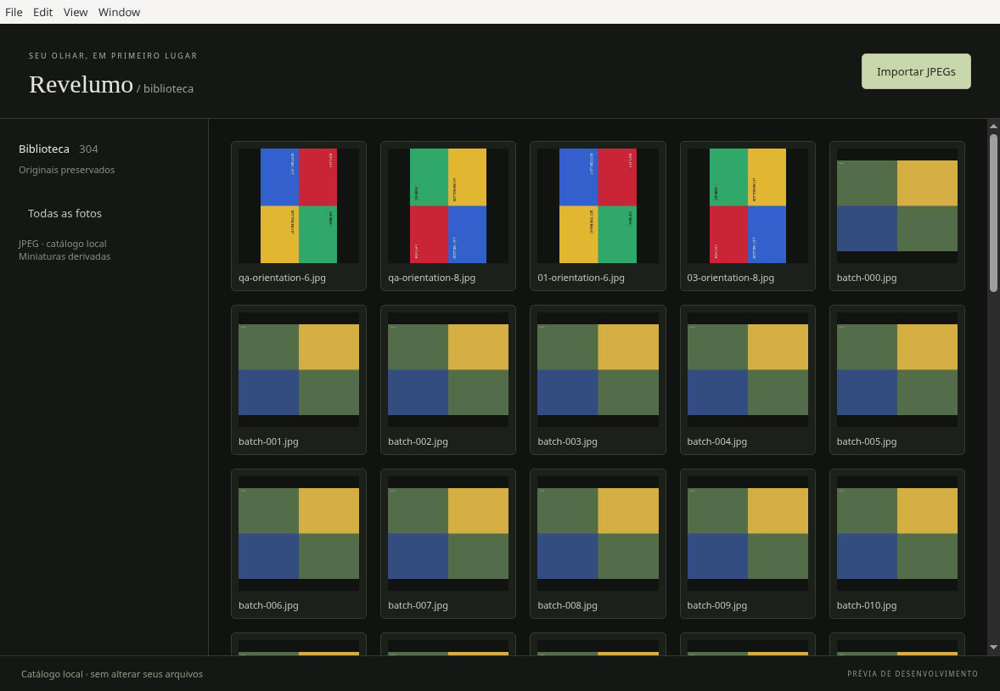
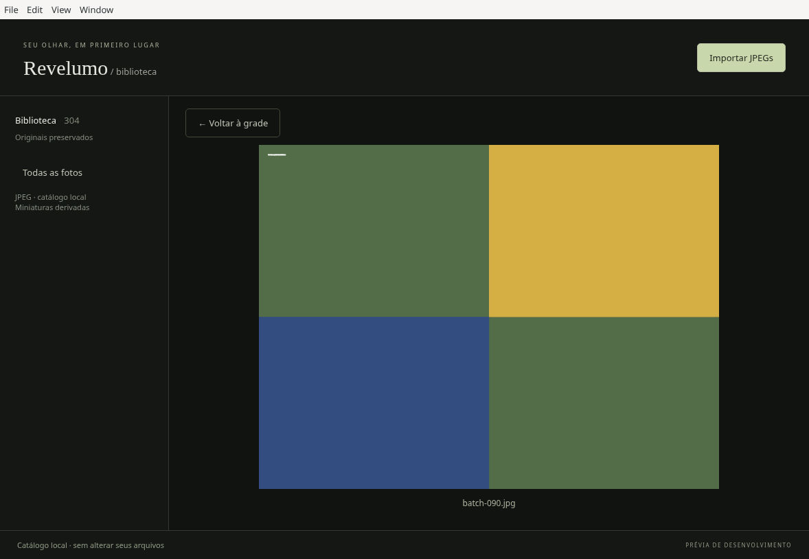
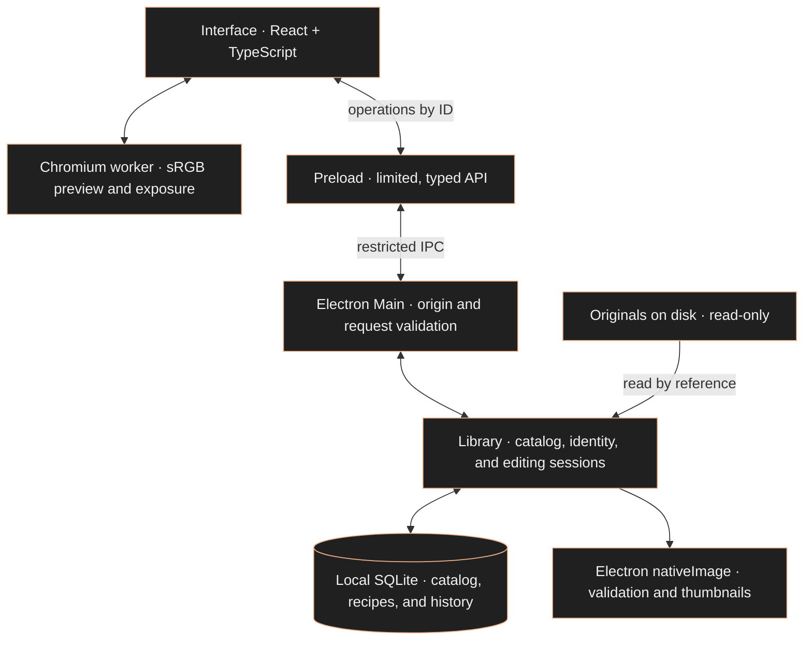

# Revelumo

**English** · [Português (Brasil)](README.pt-BR.md) · [Español](README.es.md)


<sub>Concept cover with generated demonstration images. This is not a screenshot of the application.</sub>

### Your photographs. On your computer.

An independent desktop photo editor for hobbyists and enthusiasts. A local library to organize your photos and start developing JPEGs while preserving the originals.

**Local · No subscription · No AI features in the product**

[](https://github.com/glaucia86/revelumo/actions/workflows/ci.yml)


[Interface](#interface) · [Current features](#status) · [Try it](#instalacao) · [Development](#desenvolvimento) · [Architecture](#arquitetura) · [Roadmap](#roadmap)

> **Development preview.** Revelumo already has a working desktop interface: a library, ratings, filters, and exposure editing with persistent history. There is no public release or installer yet. To try it, you need to run the project from source. The MVP and cross-platform validation are still in progress.

<a id="visao"></a>
## Your photography stays with you

- **Local library.** Your catalog and adjustments stay on your computer, without cloud photo processing or synchronization.
- **Preserved originals.** Importing records a reference to the file. The application does not move or overwrite the photograph.
- **Non-destructive editing.** Exposure is stored as a separate recipe and applied to the preview.
- **Independent development.** Zero cost and no subscription guide the project. The repository is public; its license has yet to be chosen.

Lightroom Classic is a functional reference for the library and editing workflow. Revelumo has its own identity, with no Adobe affiliation or promise of feature parity.

<a id="interface"></a>
## A working desktop interface

The application opens an Electron window with a React interface. You can import JPEGs, browse thumbnails, rate photos, and filter the library. Opening a photo lets you adjust exposure, compare it with 0 EV, and undo or redo adjustments.

### The library in action



<sub>Actual screenshot from the JPEG batch-import milestone on Linux, using synthetic test images. This predates the current rating, filtering, and editing controls. [Milestone report](evidence/batch-jpeg/report.md).</sub>

<details>
<summary>See the photo preview from the same milestone</summary>



This screenshot records grid-to-preview navigation before the exposure editor was added. The current controls and their verification are described in the [exposure](evidence/issue-12/report.md) and [persistent history](evidence/issue-16/report.md) reports.

</details>

**Selected visual direction: A · Cobre (Copper).** A neutral dark workspace with copper accents on controls and selections has been chosen for the redesign. This approves the design direction; the mockup has not been integrated into the application. The screenshots above document the existing implementation.

**Languages:** the current app interface is in Portuguese. This README is available in English, Brazilian Portuguese, and Spanish; language selection inside the app is planned and is not available yet.

<a id="status"></a>
## What you can do today

| Feature | Available in the current implementation |
| :--- | :--- |
| Import JPEGs | Multiple files imported by reference, per-file progress and errors; importing the same canonical path again reuses the catalog entry |
| Browse the library | Derived thumbnail grid, 48 photos per page, and a preview of the selected photo |
| Rate photos | 1–5 stars or unrated; selected, rejected, and unflagged states |
| Filter the library | Minimum star rating or unrated, combined with a flag; filters are retained when returning from the preview within the session |
| Locate missing originals | Missing-file notices and individual relocation by SHA-256 identity, preserving the photo ID, rating, and adjustments |
| Adjust exposure | −3 to +3 EV in 0.1 EV steps, with gain in linear RGB; comparison with 0 EV and reset |
| Save adjustments | A recipe in SQLite, autosave, and confirmation before leaving the editor or closing normally |
| Undo and redo | Persistent exposure history retaining the latest 100 steps per photo, without time-based expiration |

### A workflow to try

1. Click **Importar JPEGs** (Import JPEGs) and select photographs on your computer.
2. Open a thumbnail, assign stars or a flag, and return to the grid to filter the library.
3. Open a photo and adjust **Exposição** (Exposure) with the slider or numeric field.
4. Try **Comparar com 0 EV** (Compare with 0 EV), **Redefinir exposição** (Reset exposure), **Desfazer exposição** (Undo exposure), and **Refazer exposição** (Redo exposure).
5. Wait for the saved confirmation. Close and reopen the app to continue with the persisted catalog, recipe, and history.

A complete drag or completed numeric edit counts as one history step, even if autosave runs during a pause. A new adjustment after undoing discards the redo path. Beyond 100 steps, the oldest steps are no longer available. The current history covers exposure only. [Behavior and limits](docs-agents/issue-16-contract.md).

### Important limits

- **JPEG at this stage:** up to 32 MiB and 40 megapixels per file, within the frame types accepted by the initial validation. RAW and HEIC are not supported yet.
- **Editing preview:** an sRGB derivative, up to 2048 px on its longest side. This is not a full-resolution export; gamut, clipping, and quantization limit the preview.
- **Color and orientation:** synthetic sRGB/Display-P3 fixtures and EXIF orientations 1–8 have been verified in Electron. Broad compatibility with cameras, ICC profiles, and professional workflows still needs evaluation.
- **Persistence:** an interruption recovers the last state actually saved. Later changes that have not been persisted may be lost.
- **Originals:** the catalog is not a backup. Keep your own backups of the photos and catalog.
- **Still in development:** white balance, cropping, and JPEG export. These features are not available in the integrated version described here.

<details>
<summary>How locating a missing original works</summary>

The thumbnail remains in the catalog when the original moves. The grid checks availability when loading a page, returning to the app, or clicking **Verificar disponibilidade** (Check availability), without reading or hashing every original. File presence does not prove integrity; the selected photo receives the full check.

**Localizar original** (Locate original) accepts one file at a time and requires exactly the same bytes, verified by SHA-256. The ID, cataloged name, and associated data are preserved. Reimporting different content at the same path does not silently replace the recorded identity.

An older entry without an identity whose original is already missing cannot be safely relinked. In that case, you can import the file as a new entry and keep the old one. [Identity policy](docs-agents/adr/0003-original-identity-relocation.md) · [Relocation checks](evidence/relocation-windows/report.md).

</details>

<a id="instalacao"></a>
## How to try it

**There is no `.exe` installer, `.dmg` image, or Linux package published as a release yet.** The commands below prepare a development copy on your computer. Packaging generates an application folder; it does not install Revelumo on the system.

### Prerequisites

- [Git](https://git-scm.com/downloads).
- [Node.js 24](https://nodejs.org/en/download), with npm. This is the version used by CI.
- Internet access to download the source, dependencies, and official Electron binary.
- A graphical session to open the application. Linux also needs the system libraries required by Electron for your distribution.

Check your terminal:

```sh
git --version
node --version
npm --version
```

You do not need a separate SQLite server: the catalog uses SQLite provided by the Node/Electron runtime. See the framework's [development prerequisites](https://www.electronjs.org/docs/latest/tutorial/tutorial-prerequisites).

### Prepare the source

In **PowerShell or Command Prompt on Windows**, **Terminal on macOS**, or a **Linux terminal**, run:

```sh
git clone https://github.com/glaucia86/revelumo.git
cd revelumo
npm ci
npm run install:electron
npm run typecheck
npm test
```

`npm ci` uses the repository's lockfile. `install:electron` downloads the official binary required by this Electron version, which does not automatically install it with the npm package. If a command fails, resolve that failure before continuing.

### Open it on your system

| System | Development path | What has been verified |
| :--- | :--- | :--- |
| Windows | PowerShell or Command Prompt; use the common commands above and below | x64 package, tests, and automated Electron integration; visual inspection and the native Windows dialog are still pending |
| macOS | Terminal; the same commands are the starting point | Not yet validated on macOS, Intel, or Apple Silicon; execution is not guaranteed at this stage |
| Linux | Terminal in a graphical session; use the common commands | x64 package launched and workflows visually inspected in one Linux environment; this does not establish support for every distribution |

To start development mode:

```sh
npm start
```

This command is configured in the project, but its complete workflow has not yet been validated end to end. Existing evidence focuses on the packaged application.

Alternatively, build a local package on your own system:

```sh
npm run package
```

The output is in `out/`. For the x64 targets already packaged, the executable is located at:

- **Windows:** `out/Revelumo-win32-x64/Revelumo.exe`.
- **Linux:** `out/Revelumo-linux-x64/Revelumo`.
- **macOS:** the `.app` output still needs to be produced and validated for this project.

The Windows executable in this folder is a development package, not an installer. Keep the folder's files together. The configuration currently uses `makers: []`: `npm run make` is not a ready-to-use installer-generation workflow. [Package versus make in Forge](https://www.electronforge.io/cli).

> Minimum OS versions, supported architectures, and memory requirements have not been established. A computer with 8 GB RAM and no dedicated GPU is a test target, not a proven minimum requirement. Do not disable system protections to try opening a build.

<a id="desenvolvimento"></a>
## Development and verification

### Main commands

| Command | Purpose |
| :--- | :--- |
| `npm run typecheck` | Check TypeScript types |
| `npm test` | Run the core suite with real Node, filesystem, and SQLite |
| `npm start` | Open Electron Forge development mode |
| `npm run package` | Generate the local application in `out/`, without an installer |

To run only the core tests with Node.js 24, you do not need to install dependencies:

```sh
node --test test/*.test.ts
```

Node's type stripping does not replace typechecking. Core tests substitute the decoder; integration with the real decoder, worker, canvas, IPC, and renderer is exercised by the packaged Electron tests.

### CI and evidence

The [CI workflow](.github/workflows/ci.yml) checks PRs, pushes to `main`, and manual runs on **Windows and Ubuntu**, using Node 24, lockfile installation, typechecking, tests, and packaging. Windows also runs import, relocation, filtering, exposure, and history scenarios in the packaged Electron app, including reopening in separate processes.

- [Current GitHub Actions runs](https://github.com/glaucia86/revelumo/actions/workflows/ci.yml)
- [Reproducing CI and platform-specific limits](docs-agents/ci.md)
- [Batch import, grid, and interruption on Linux](evidence/batch-jpeg/report.md)
- [Classification and filters on Windows](evidence/filters-windows/report.md)
- [Exposure, autosave, color, and resource measurements](evidence/issue-12/report.md)
- [Persistent history, retention, and Linux visual QA](evidence/issue-16/report.md)

Reports record each milestone's revision and environment; references to pending publication or CI in those records are historical. Consult PRs and Actions for the remote status. Automated tests use synthetic images and substitute the native dialog at the file-selection boundary. They do not establish validation with real photographs, screen readers, 8 GB hardware, or macOS. Most detailed engineering reports are currently in Portuguese.

CI keeps results in logs and job summaries, without package uploads or persistent caches. The CI matrix is not an end-user support declaration.

<a id="arquitetura"></a>
## Local architecture



- **Interface:** library, filters, classification, and editing controls. The renderer receives neither original file paths nor direct access to Node, files, or SQLite.
- **Preload and main:** the [typed API](src/shared/contracts.ts) and [request validation](src/shared/requests.ts) restrict operations. Dialogs and file access belong to the main process; the window maintains context isolation, sandboxing, and disabled Node integration in the renderer.
- **Catalog:** `app.getPath('userData')/catalog.sqlite` stores references, identity, thumbnails, classification, recipes, and history. The current schema is **v6**, with a transactional migration from v5; older versions that do not recognize the new schema refuse the database without deleting it.
- **Editing:** the API delivers the original JPEG to prepare the preview; the worker derives a reduced sRGB image and applies exposure in linear RGB. History stores values and metadata, without an image per step. The recipe, cursor, and checkpoint are persisted transactionally.

**Implemented stack:** Electron, React, TypeScript, Vite/Electron Forge, and SQLite. No Rust code is integrated, and installing Rust is not required for this version.

**Open decisions:** the RAW engine, a possible native worker in Rust or C++, and the product license. RawTherapee was evaluated in an [initial Windows experiment](evidence/rawtherapee-cli-windows/report.md); that investigation did not select the engine or approve it as a dependency.

[Catalog and IPC](docs-agents/adr/0001-local-catalog-ipc.md) · [Batches and thumbnails](docs-agents/adr/0002-batch-jpeg-thumbnails.md) · [Exposure and autosave](docs-agents/adr/0004-jpeg-exposure-autosave.md) · [Persistent history](docs-agents/issue-16-contract.md)

<a id="roadmap"></a>
## The path to the first MVP

| Milestone | Status |
| :--- | :--- |
| Local JPEG library | Import, grid, thumbnails, persistence, and relocation implemented |
| Organization | Stars, flags, and filters implemented |
| First non-destructive editing tools | Exposure, autosave, and persistent 100-step history implemented |
| White balance and cropping | In development; not yet available in the integrated version |
| JPEG export | In development; new output files are not yet available |
| Visual redesign | A · Cobre (Copper) direction selected; implementation pending |
| App languages: Portuguese, English, and Spanish | Planned; language selection not implemented |
| RAW, HEIC reading, TIFF export, and batch adjustments | Planned; dependent on further decisions and validation |
| Distribution | Installers, releases, and broader platform validation still pending |

HDR and HEIC export are outside the first MVP. The roadmap describes a direction, without promised delivery dates.

## Follow the project

Decisions, dependencies, and ongoing work are tracked in [GitHub Issues](https://github.com/glaucia86/revelumo/issues) and [pull requests](https://github.com/glaucia86/revelumo/pulls). Terms for public contributions still need to be defined.

**License:** not yet chosen. A public repository does not grant an open-source license.

---

## Creator

<p align="center">
  <a href="https://github.com/glaucia86"></a>
</p>

### Glaucia Lemos

Principal Software Engineer, former Microsoft employee, Microsoft MVP, and Codex Ambassador. She creates technical content, gives talks, and runs live coding sessions about JavaScript, TypeScript, and software development. She is the creator of Revelumo.

[GitHub](https://github.com/glaucia86) · [LinkedIn](https://www.linkedin.com/in/glaucialemos/) · [X / Twitter](https://twitter.com/glaucia_lemos86) · [YouTube](https://www.youtube.com/user/l32759) · [Twitch](https://www.twitch.tv/glaucia_lemos86) · [More links](https://linktr.ee/glaucia_lemos86)

---

**Revelumo · Photography comes first.**
