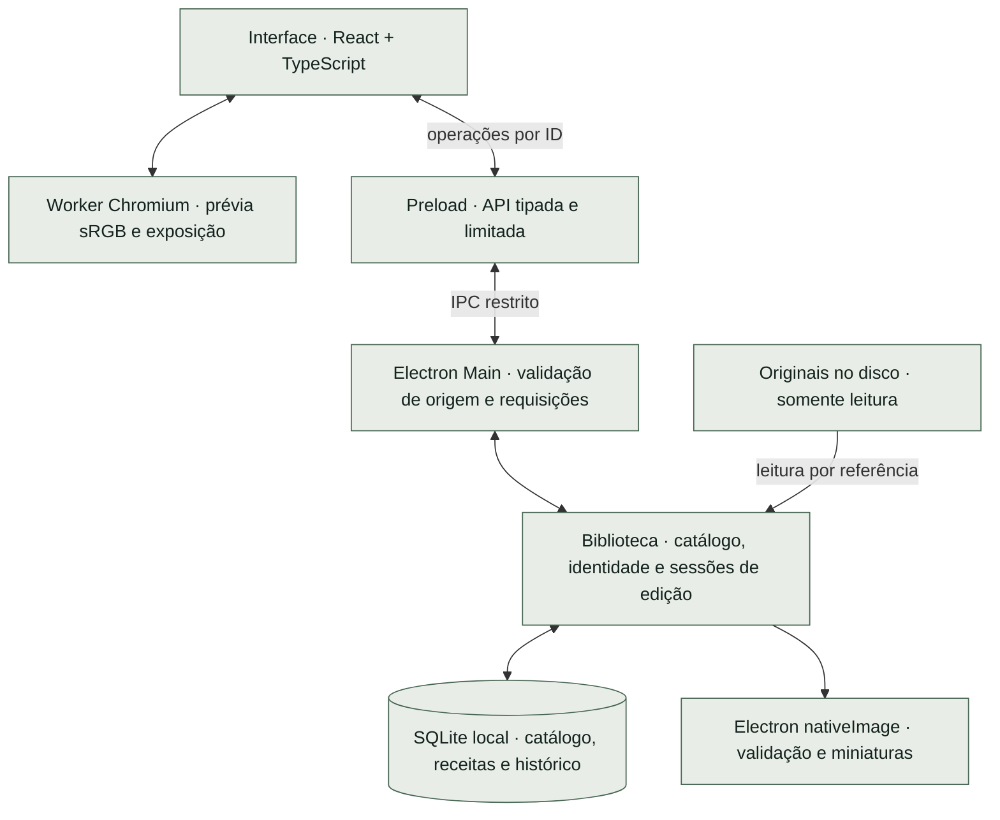

# Revelumo


<sub>Capa conceitual com imagens demonstrativas geradas. Não é uma captura do aplicativo.</sub>

### Suas fotografias. No seu computador.

Editor fotográfico desktop independente para amadores e entusiastas. Uma biblioteca local para organizar suas fotos e começar a revelar JPEGs, com os originais preservados.

**Local · Sem assinatura · Sem funcionalidades de IA no produto**

[](https://github.com/glaucia86/revelumo/actions/workflows/ci.yml)


[Interface](#interface) · [Recursos atuais](#status) · [Experimentar](#instalacao) · [Desenvolvimento](#desenvolvimento) · [Arquitetura](#arquitetura) · [Roadmap](#roadmap)

> **Prévia de desenvolvimento.** O Revelumo já tem interface desktop funcional: biblioteca, classificação, filtros e edição de exposição com histórico persistente. Ainda não há release ou instalador para o público. Para experimentar, é necessário executar o projeto a partir do código-fonte. O MVP e a validação multiplataforma continuam em construção.

<a id="visao"></a>
## A fotografia fica com você

- **Biblioteca local.** Catálogo e ajustes ficam no seu computador, sem processamento de fotos ou sincronização em nuvem.
- **Originais preservados.** Importar registra uma referência ao arquivo. O aplicativo não move nem regrava a fotografia.
- **Edição não destrutiva.** A exposição é armazenada como uma receita separada e aplicada à prévia.
- **Construção independente.** Custo zero e ausência de assinatura orientam o projeto. O repositório é público; a licença ainda precisa ser definida.

Lightroom Classic é uma referência funcional para o fluxo de biblioteca e edição. O Revelumo tem identidade própria, sem vínculo com a Adobe ou promessa de paridade de recursos.

<a id="interface"></a>
## Uma interface que já funciona

O aplicativo abre em uma janela Electron com interface React. A biblioteca permite importar JPEGs, navegar pelas miniaturas, classificar fotos e filtrar a seleção. Ao abrir uma foto, você pode ajustar a exposição, comparar com 0 EV e desfazer ou refazer ajustes.

### Biblioteca em execução


<sub>Captura real da etapa de lote JPEG, no Linux, com imagens sintéticas de teste. É um registro anterior aos controles atuais de classificação, filtros e edição. [Relatório dessa etapa](evidence/batch-jpeg/report.md).</sub>

<details>
<summary>Ver a prévia de uma foto nessa mesma etapa</summary>


A captura documenta a navegação entre grade e prévia antes da inclusão do editor de exposição. Os controles atuais e suas verificações estão descritos nos relatórios de [exposição](evidence/issue-12/report.md) e [histórico persistente](evidence/issue-16/report.md).

</details>

**Evolução visual:** a proposta de interface UI V2, explorada com OpenDesign, ainda não está integrada ao aplicativo. Ela é uma direção visual em avaliação, separada dos recursos disponíveis abaixo.

<a id="status"></a>
## O que você pode fazer hoje

| Recurso | Disponível na implementação atual |
| :--- | :--- |
| Importar JPEGs | Seleção múltipla por referência, progresso e falhas por arquivo; reimportação do mesmo caminho canônico reaproveita o registro |
| Navegar pela biblioteca | Grade de miniaturas derivadas, 48 fotos por página e abertura da foto selecionada |
| Classificar fotos | De 1 a 5 estrelas ou sem avaliação; marcações selecionada, rejeitada e sem flag |
| Filtrar a biblioteca | Estrelas mínimas ou sem avaliação, combinadas com a marcação; filtros preservados ao voltar da prévia durante a sessão |
| Reencontrar originais | Aviso de arquivo ausente e relocalização individual por identidade SHA-256, preservando ID, classificação e ajustes |
| Ajustar exposição | De −3 a +3 EV, em passos de 0,1 EV, com ganho em RGB linear; comparação com 0 EV e redefinição |
| Salvar ajustes | Receita no SQLite, autosave e confirmação ao sair da edição ou fechar normalmente |
| Desfazer e refazer | Histórico de exposição persistente, com os últimos 100 passos por foto, sem expiração por tempo |

### Um fluxo para experimentar

1. Clique em **Importar JPEGs** e escolha as fotografias no seu computador.
2. Abra uma miniatura, atribua estrelas ou uma marcação e volte à grade para filtrar a biblioteca.
3. Abra uma foto e ajuste a **Exposição**, pelo controle deslizante ou pelo campo numérico.
4. Use **Comparar com 0 EV**, **Redefinir exposição**, **Desfazer exposição** e **Refazer exposição** para explorar o resultado.
5. Aguarde a confirmação de salvamento. Feche e reabra o aplicativo para continuar com o catálogo, a receita e o histórico persistidos.

Um arraste completo ou uma edição numérica concluída representa um passo do histórico, mesmo se houver autosave durante uma pausa. Um novo ajuste depois de desfazer elimina o caminho de refazer. Ao ultrapassar 100 passos, os mais antigos deixam de estar disponíveis. O histórico atual cobre somente exposição. [Contrato e limites](docs-agents/issue-16-contract.md).

### Limites importantes

- **JPEG nesta etapa:** até 32 MiB e 40 megapixels por arquivo, dentro dos tipos aceitos pela validação inicial. RAW e HEIC ainda não são suportados.
- **Prévia de edição:** derivada em sRGB, com até 2048 px no maior lado. Não representa uma exportação em resolução original; gamut, clipping e quantização limitam a prévia.
- **Cor e orientação:** fixtures sintéticas sRGB/Display-P3 e EXIF 1–8 foram verificadas no Electron. Compatibilidade ampla com câmeras, perfis ICC e fluxos profissionais ainda precisa ser avaliada.
- **Persistência:** uma interrupção recupera o último estado realmente salvo. Alterações posteriores ainda não persistidas podem ser perdidas.
- **Originais:** o catálogo não é uma cópia de segurança. Mantenha seus próprios backups das fotos e do catálogo.
- **Ainda em desenvolvimento:** balanço de branco, recorte e exportação JPEG. Esses recursos não estão disponíveis nesta versão integrada.

<details>
<summary>Como funciona a relocalização de um original</summary>

A miniatura permanece no catálogo quando o original muda de lugar. A grade verifica disponibilidade ao carregar a página, voltar ao aplicativo ou acionar **Verificar disponibilidade**, sem ler ou calcular hash de todos os originais. Presença no disco não comprova integridade; a foto selecionada passa pela verificação completa.

**Localizar original** aceita um arquivo por vez e exige exatamente os mesmos bytes, comprovados por SHA-256. ID, nome catalogado e dados associados são preservados. Reimportar conteúdo diferente no mesmo caminho não substitui silenciosamente a identidade registrada.

Um registro antigo sem identificação cujo original já esteja ausente não pode ser religado com segurança. Nesse caso, é possível importar o arquivo como um novo registro e manter o anterior. [Política de identidade](docs-agents/adr/0003-original-identity-relocation.md) · [Verificações de relocalização](evidence/relocation-windows/report.md).

</details>

<a id="instalacao"></a>
## Como experimentar

**Ainda não há instalador `.exe`, imagem `.dmg` ou pacote Linux publicado como release.** Os comandos abaixo preparam uma cópia de desenvolvimento no seu computador. O empacotamento gera uma pasta de aplicativo, sem instalar o Revelumo no sistema.

### Pré-requisitos

- [Git](https://git-scm.com/downloads).
- [Node.js 24](https://nodejs.org/en/download), com npm. Essa é a versão utilizada pelo CI.
- Internet para baixar o código, as dependências e o binário oficial do Electron.
- Uma sessão gráfica para abrir o aplicativo. No Linux, também são necessárias as bibliotecas de sistema exigidas pelo Electron da sua distribuição.

Confira no terminal:

```sh
git --version
node --version
npm --version
```

Não é necessário instalar um servidor SQLite: o catálogo usa o SQLite fornecido pelo runtime Node/Electron. Os requisitos de desenvolvimento do framework estão na [documentação do Electron](https://www.electronjs.org/docs/latest/tutorial/tutorial-prerequisites).

### Preparar o código-fonte

No **PowerShell ou Prompt de Comando do Windows**, no **Terminal do macOS** ou no **terminal do Linux**, execute:

```sh
git clone https://github.com/glaucia86/revelumo.git
cd revelumo
npm ci
npm run install:electron
npm run typecheck
npm test
```

`npm ci` usa o lockfile do repositório. `install:electron` baixa o binário oficial necessário nesta versão do Electron, que não o instala automaticamente junto com o pacote npm. Se um comando falhar, resolva a falha antes de seguir para a próxima etapa.

### Abrir no seu sistema

| Sistema | Caminho de desenvolvimento | O que já foi verificado |
| :--- | :--- | :--- |
| Windows | PowerShell ou Prompt de Comando; execute os comandos comuns acima e abaixo | Pacote x64, testes e integrações automatizadas no Electron; inspeção visual e diálogo nativo Windows ainda pendentes |
| macOS | Terminal; os mesmos comandos são o ponto de partida | Ainda sem validação no macOS, Intel ou Apple Silicon; não há garantia de execução nesta etapa |
| Linux | Terminal em sessão gráfica; execute os comandos comuns | Pacote x64 aberto e fluxos inspecionados em um ambiente Linux; isso não estabelece suporte a todas as distribuições |

Para iniciar em modo de desenvolvimento:

```sh
npm start
```

Esse comando está configurado no projeto, mas seu fluxo completo ainda não foi validado de ponta a ponta. As evidências existentes se concentram no aplicativo empacotado.

Como alternativa, gere o pacote local no próprio sistema:

```sh
npm run package
```

A saída fica em `out/`. Nos alvos x64 já empacotados, o executável está em:

- **Windows:** `out/Revelumo-win32-x64/Revelumo.exe`.
- **Linux:** `out/Revelumo-linux-x64/Revelumo`.
- **macOS:** a saída `.app` ainda precisa ser produzida e validada no projeto.

O executável Windows dentro dessa pasta é um pacote de desenvolvimento, não um instalador. Mantenha os arquivos da pasta juntos. A configuração atual usa `makers: []`: `npm run make` não é um caminho pronto para gerar instaladores. [Diferença entre package e make no Forge](https://www.electronforge.io/cli).

> Versões mínimas dos sistemas, arquiteturas suportadas e requisitos de memória ainda não foram estabelecidos. Um computador com 8 GB de RAM e sem GPU dedicada é um alvo de teste, não um requisito mínimo comprovado. Não desative as proteções do sistema para tentar abrir uma compilação.

<a id="desenvolvimento"></a>
## Desenvolvimento e verificação

### Comandos principais

| Comando | Finalidade |
| :--- | :--- |
| `npm run typecheck` | Validar tipos TypeScript |
| `npm test` | Executar a suíte do núcleo com Node, filesystem e SQLite reais |
| `npm start` | Abrir o modo de desenvolvimento do Electron Forge |
| `npm run package` | Gerar o aplicativo local em `out/`, sem instalador |

Para executar somente os testes do núcleo, com Node.js 24, não é necessário instalar as dependências:

```sh
node --test test/*.test.ts
```

A remoção de tipos feita pelo Node não substitui o typecheck. Os testes do núcleo usam um substituto para o decodificador; a integração com decoder, worker, canvas, IPC e renderer reais é exercitada nos testes do Electron empacotado.

### CI e evidências

O [workflow de CI](.github/workflows/ci.yml) verifica PRs, pushes em `main` e execuções manuais em **Windows e Ubuntu**, com Node 24, instalação pelo lockfile, typecheck, testes e empacotamento. O Windows também executa os cenários de importação, relocalização, filtros, exposição e histórico no Electron empacotado, incluindo reabertura em processos separados.

- [Execuções atuais no GitHub Actions](https://github.com/glaucia86/revelumo/actions/workflows/ci.yml)
- [Reprodução do CI e limites de cada sistema](docs-agents/ci.md)
- [Importação em lote, grade e interrupção no Linux](evidence/batch-jpeg/report.md)
- [Classificação e filtros no Windows](evidence/filters-windows/report.md)
- [Exposição, autosave, cor e recursos medidos](evidence/issue-12/report.md)
- [Histórico persistente, retenção e QA visual Linux](evidence/issue-16/report.md)

Os relatórios registram a revisão e o ambiente de cada etapa; referências a publicação ou CI pendentes nesses registros são históricas. O estado remoto deve ser consultado nos PRs e no Actions. Os testes automatizados usam imagens sintéticas e substituem o diálogo nativo na fronteira de seleção de arquivos. Não equivalem a validação com fotografias reais, leitor de tela, hardware de 8 GB ou macOS.

O CI mantém os resultados nos logs e no resumo dos jobs, sem upload de pacotes ou cache persistente. A matriz de CI não é uma declaração de suporte ao usuário final.

<a id="arquitetura"></a>
## Arquitetura local



- **Interface:** biblioteca, filtros, classificação e controles de edição. O renderer não recebe caminhos dos originais nem acesso direto a Node, arquivos ou SQLite.
- **Preload e main:** a [API tipada](src/shared/contracts.ts) e a [validação de requisições](src/shared/requests.ts) restringem as operações. Diálogos e acesso a arquivos pertencem ao main; a janela mantém isolamento de contexto, sandbox e Node desabilitado no renderer.
- **Catálogo:** `app.getPath('userData')/catalog.sqlite` guarda referências, identidade, miniaturas, classificação, receitas e histórico. O schema atual é **v6**, com migração transacional de v5; versões antigas que não conhecem o novo schema recusam o banco, sem apagá-lo.
- **Edição:** a API entrega o JPEG original para preparar a prévia; o worker deriva uma imagem sRGB reduzida e aplica a exposição em RGB linear. O histórico armazena valores e metadados, sem uma imagem por passo. Receita, cursor e checkpoint são persistidos de forma transacional.

**Decisões em aberto:** motor RAW, eventual worker nativo em Rust ou C++ e licença do produto. RawTherapee foi avaliado em um [experimento inicial no Windows](evidence/rawtherapee-cli-windows/report.md); a investigação não definiu o motor nem aprovou sua adoção como dependência.

[Catálogo e IPC](docs-agents/adr/0001-local-catalog-ipc.md) · [Lote e miniaturas](docs-agents/adr/0002-batch-jpeg-thumbnails.md) · [Exposição e autosave](docs-agents/adr/0004-jpeg-exposure-autosave.md) · [Histórico persistente](docs-agents/issue-16-contract.md)

<a id="roadmap"></a>
## O caminho até o primeiro MVP

| Etapa | Situação |
| :--- | :--- |
| Biblioteca JPEG local | Importação, grade, miniaturas, persistência e relocalização implementadas |
| Organização | Estrelas, marcações e filtros implementados |
| Primeira edição não destrutiva | Exposição, autosave e histórico persistente de 100 passos implementados |
| Balanço de branco e recorte | Em desenvolvimento; ainda não disponíveis na versão integrada |
| Exportação JPEG | Em desenvolvimento; geração de novos arquivos ainda não disponível |
| Evolução visual UI V2 | Proposta em avaliação, ainda não integrada |
| RAW, leitura HEIC, exportação TIFF e ajustes em lote | Planejados; dependem das próximas decisões e validações |
| Distribuição | Instaladores, releases e validação ampliada por sistema ainda pendentes |

HDR e exportação HEIC ficam para depois do MVP. O roadmap indica direção, sem datas de entrega prometidas.

## Acompanhe a construção

Decisões, dependências e trabalho em andamento estão em [GitHub Issues](https://github.com/glaucia86/revelumo/issues) e [pull requests](https://github.com/glaucia86/revelumo/pulls). As condições para contribuições públicas ainda precisam ser definidas.

**Licença:** pendente de escolha. A visibilidade pública do repositório não concede uma licença open source.

---

<div align="center">

Criado por **[Glaucia Lemos](https://github.com/glaucia86)** · Principal Software Engineer · Codex Ambassador

**Revelumo · Fotografia em primeiro lugar.**

</div>
