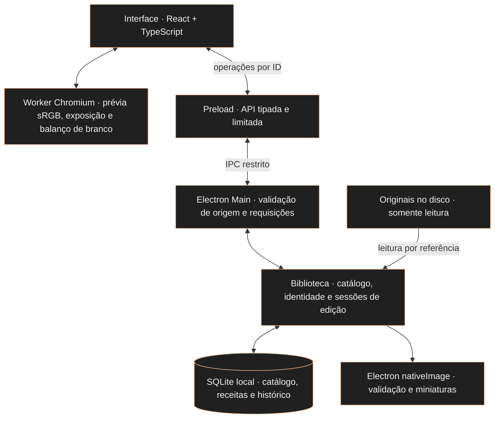

<a id="topo"></a>
<div align="center">

<h1>Revelumo</h1>
<p><a href="README.md">English</a> · <strong>Português (Brasil)</strong> · <a href="README.es.md">Español</a></p>
<p><strong>Suas fotografias. No seu computador.</strong></p>
<p>Editor fotográfico desktop independente para amadores e entusiastas.<br>Uma biblioteca local para organizar e editar JPEGs, com os originais preservados.</p>
<p><strong>Local · Sem assinatura · Sem funcionalidades de IA no produto</strong></p>


<p><sub>Catálogo Cobre real no aplicativo Linux empacotado, com JPEGs importados pelo próprio programa. Build de desenvolvimento, sem instalador público. <a href="docs/assets/screenshots/README.md">Detalhes da captura e créditos das fotos</a>.</sub></p>

<p>
<a href="https://github.com/glaucia86/revelumo/actions/workflows/ci.yml"></a>
<a href="LICENSE"></a>


</p>
</div>

---

## Sumário

- [Visão do projeto](#visao)
- [Interface em funcionamento](#interface)
- [Recursos atuais e limites](#status)
- [Experimente o aplicativo](#instalacao)
- [Desenvolvimento e verificações](#desenvolvimento)
- [Arquitetura e Rust](#arquitetura)
- [Roadmap](#roadmap)
- [Como contribuir](#contributing)
- [Suporte e segurança](#support)
- [Licença e terceiros](#license)
- [Sobre a criadora](#creator)

> **Prévia de desenvolvimento.** O Revelumo já tem interface desktop funcional: biblioteca, classificação, filtros, edição de exposição com histórico persistente e balanço de branco relativo. Ainda não há release ou instalador para o público. Para experimentar, é necessário executar o projeto a partir do código-fonte. O MVP e a validação multiplataforma continuam em construção.

<a id="visao"></a>
## A fotografia fica com você

- **Biblioteca local.** Catálogo e ajustes ficam no seu computador, sem processamento de fotos ou sincronização em nuvem.
- **Originais preservados.** Importar registra uma referência ao arquivo. O aplicativo não move nem regrava a fotografia.
- **Edição não destrutiva.** Exposição e balanço de branco relativo são armazenados como uma receita separada e aplicados à prévia.
- **Construção independente.** Custo zero e ausência de assinatura orientam o projeto. Código e documentação originais estão sob MIT, com os direitos de terceiros preservados.

Lightroom Classic é uma referência funcional para o fluxo de biblioteca e edição. O Revelumo tem identidade própria, sem vínculo com a Adobe ou promessa de paridade de recursos.

<a id="interface"></a>
## Uma interface que já funciona

O aplicativo abre em uma janela Electron com interface React. A biblioteca permite importar JPEGs, navegar pelas miniaturas, classificar fotos e filtrar a seleção. Ao abrir uma foto, você pode ajustar exposição e balanço de branco relativo, comparar com 0 EV mantendo o balanço de branco e desfazer ou refazer alterações de exposição.

### O catálogo atual

A imagem principal acima mostra o catálogo **A · Cobre** implementado: ambiente escuro neutro, detalhes em cobre, JPEGs locais e filtros da biblioteca. As imagens foram realmente importadas no aplicativo empacotado. [Implementação e verificação](evidence/cobre-catalog/report.md).

### Editando uma foto


O editor já oferece exposição, balanço de branco relativo, autosave e histórico de exposição. Esta é sua interface funcional atual; o redesenho completo do editor em Cobre continua planejado. [Detalhes da captura e créditos das fotos](docs/assets/screenshots/README.md).

**Idiomas:** a interface atual do aplicativo está em português. Este README está disponível em inglês, português do Brasil e espanhol; a seleção de idioma dentro do aplicativo está planejada e ainda não está disponível.

<a id="status"></a>
## O que você pode fazer hoje

| Recurso | Disponível na implementação atual |
| :--- | :--- |
| Importar JPEGs | Seleção múltipla por referência, progresso e falhas por arquivo; reimportação do mesmo caminho canônico reaproveita o registro |
| Navegar pela biblioteca | Grade de miniaturas derivadas, 48 fotos por página e abertura da foto selecionada |
| Classificar fotos | De 1 a 5 estrelas ou sem avaliação; marcações selecionada, rejeitada e sem flag |
| Filtrar a biblioteca | Estrelas mínimas ou sem avaliação, combinadas com a marcação; filtros preservados ao voltar da prévia durante a sessão |
| Reencontrar originais | Aviso de arquivo ausente e relocalização individual por identidade SHA-256, preservando ID, classificação e ajustes |
| Ajustar exposição | De −3 a +3 EV, em passos de 0,1 EV, com ganho em RGB linear; comparação com 0 EV e redefinição |
| Ajustar balanço de branco | Temperatura e matiz relativos de −100 a +100, em passos inteiros; redefinição dos dois sem alterar a exposição |
| Salvar ajustes | Receita no SQLite, autosave e confirmação ao sair da edição ou fechar normalmente |
| Desfazer e refazer | Histórico de exposição persistente, com os últimos 100 passos por foto, sem expiração por tempo |

### Um fluxo para experimentar

1. Clique em **Importar JPEGs** e escolha as fotografias no seu computador.
2. Abra uma miniatura, atribua estrelas ou uma marcação e volte à grade para filtrar a biblioteca.
3. Abra uma foto e ajuste a **Exposição**, pelo controle deslizante ou pelo campo numérico.
4. Ajuste **Temperatura** e **Matiz** ou use **Redefinir balanço de branco**. São controles relativos, sem escala Kelvin.
5. Use **Comparar com 0 EV**, **Redefinir exposição**, **Desfazer exposição** e **Refazer exposição** para explorar o resultado.
6. Aguarde a confirmação de salvamento. Feche e reabra o aplicativo para continuar com o catálogo, a receita e o histórico persistidos.

Um arraste completo ou uma edição numérica concluída representa um passo do histórico, mesmo se houver autosave durante uma pausa. Um novo ajuste depois de desfazer elimina o caminho de refazer. Ao ultrapassar 100 passos, os mais antigos deixam de estar disponíveis. O histórico atual cobre somente exposição. Alterar o balanço de branco não cria um passo de exposição nem elimina seu caminho de refazer; desfazer exposição preserva o balanço de branco. [Contrato e limites](docs-agents/issue-16-contract.md).

### Limites importantes

- **JPEG nesta etapa:** até 32 MiB e 40 megapixels por arquivo, dentro dos tipos aceitos pela validação inicial. RAW e HEIC ainda não são suportados.
- **Prévia de edição:** derivada em sRGB, com até 2048 px no maior lado. Não representa uma exportação em resolução original; gamut, clipping e quantização limitam a prévia.
- **Cor e orientação:** fixtures sintéticas sRGB/Display-P3 e EXIF 1–8 foram verificadas no Electron. Compatibilidade ampla com câmeras, perfis ICC e fluxos profissionais ainda precisa ser avaliada.
- **Persistência:** uma interrupção recupera o último estado realmente salvo. Alterações posteriores ainda não persistidas podem ser perdidas.
- **Originais:** o catálogo não é uma cópia de segurança. Mantenha seus próprios backups das fotos e do catálogo.
- **Balanço de branco relativo:** ajusta um JPEG já renderizado, sem representar a temperatura da câmera ou revelação RAW. Não há conta-gotas, presets ou balanço automático. [Comportamento e verificação](docs-agents/adr/0005-jpeg-white-balance.md).
- **Ainda em desenvolvimento:** recorte e exportação JPEG. Esses recursos não estão disponíveis nesta versão integrada.

<details>
<summary>Como funciona a relocalização de um original</summary>

A miniatura permanece no catálogo quando o original muda de lugar. A grade verifica disponibilidade ao carregar a página, voltar ao aplicativo ou acionar **Verificar disponibilidade**, sem ler ou calcular hash de todos os originais. Presença no disco não comprova integridade; a foto selecionada passa pela verificação completa.

**Localizar original** aceita um arquivo por vez e exige exatamente os mesmos bytes, comprovados por SHA-256. ID, nome catalogado e dados associados são preservados. Reimportar conteúdo diferente no mesmo caminho não substitui silenciosamente a identidade registrada.

Um registro antigo sem identificação cujo original já esteja ausente não pode ser religado com segurança. Nesse caso, é possível importar o arquivo como um novo registro e manter o anterior. [Política de identidade](docs-agents/adr/0003-original-identity-relocation.md) · [Verificações de relocalização](evidence/relocation-windows/report.md).

</details>

<a id="instalacao"></a>
## Como experimentar

**Ainda não há instalador `.exe`, imagem `.dmg` ou pacote Linux publicado como release.** Os comandos abaixo preparam uma cópia de desenvolvimento no seu computador. O empacotamento gera uma pasta de aplicativo, sem instalar o Revelumo no sistema.

### Pré-requisitos

- [Git](https://git-scm.com/downloads).
- [Node.js 24](https://nodejs.org/en/download), com npm. Essa é a versão utilizada pelo CI.
- Internet para baixar o código, as dependências e o binário oficial do Electron.
- Uma sessão gráfica para abrir o aplicativo. No Linux, também são necessárias as bibliotecas de sistema exigidas pelo Electron da sua distribuição.

Confira no terminal:

```sh
git --version
node --version
npm --version
```

Não é necessário instalar um servidor SQLite: o catálogo usa o SQLite fornecido pelo runtime Node/Electron. Os requisitos de desenvolvimento do framework estão na [documentação do Electron](https://www.electronjs.org/docs/latest/tutorial/tutorial-prerequisites).

### Preparar o código-fonte

No **PowerShell ou Prompt de Comando do Windows**, no **Terminal do macOS** ou no **terminal do Linux**, execute:

```sh
git clone https://github.com/glaucia86/revelumo.git
cd revelumo
npm ci
npm run install:electron
npm run typecheck
npm test
```

`npm ci` usa o lockfile do repositório. `install:electron` baixa o binário oficial necessário nesta versão do Electron, que não o instala automaticamente junto com o pacote npm. Se um comando falhar, resolva a falha antes de seguir para a próxima etapa.

### Abrir no seu sistema

| Sistema | Caminho de desenvolvimento | O que já foi verificado |
| :--- | :--- | :--- |
| Windows | PowerShell ou Prompt de Comando; execute os comandos comuns acima e abaixo | Pacote x64, testes e integrações automatizadas no Electron; inspeção visual e diálogo nativo Windows ainda pendentes |
| macOS | Terminal; os mesmos comandos são o ponto de partida | Ainda sem validação no macOS, Intel ou Apple Silicon; não há garantia de execução nesta etapa |
| Linux | Terminal em sessão gráfica; execute os comandos comuns | Pacote x64 aberto e fluxos inspecionados em um ambiente Linux; isso não estabelece suporte a todas as distribuições |

Para iniciar em modo de desenvolvimento:

```sh
npm start
```

Esse comando está configurado no projeto, mas seu fluxo completo ainda não foi validado de ponta a ponta. As evidências existentes se concentram no aplicativo empacotado.

Como alternativa, gere o pacote local no próprio sistema:

```sh
npm run package
```

A saída fica em `out/`. Nos alvos x64 já empacotados, o executável está em:

- **Windows:** `out/Revelumo-win32-x64/Revelumo.exe`.
- **Linux:** `out/Revelumo-linux-x64/Revelumo`.
- **macOS:** a saída `.app` ainda precisa ser produzida e validada no projeto.

O executável Windows dentro dessa pasta é um pacote de desenvolvimento, não um instalador. Mantenha os arquivos da pasta juntos. A configuração atual usa `makers: []`: `npm run make` não é um caminho pronto para gerar instaladores. [Diferença entre package e make no Forge](https://www.electronforge.io/cli).

> Versões mínimas dos sistemas, arquiteturas suportadas e requisitos de memória ainda não foram estabelecidos. Um computador com 8 GB de RAM e sem GPU dedicada é um alvo de teste, não um requisito mínimo comprovado. Não desative as proteções do sistema para tentar abrir uma compilação.

<a id="desenvolvimento"></a>
## Desenvolvimento e verificação

### Comandos principais

| Comando | Finalidade |
| :--- | :--- |
| `npm run check:docs` | Verificar links locais e navegação entre idiomas |
| `npm run typecheck` | Validar tipos TypeScript |
| `npm test` | Executar a suíte do núcleo com Node, filesystem e SQLite reais |
| `npm start` | Abrir o modo de desenvolvimento do Electron Forge |
| `npm run package` | Gerar o aplicativo local em `out/`, sem instalador |

Para executar somente os testes do núcleo, com Node.js 24, não é necessário instalar as dependências:

```sh
node --test test/*.test.ts
```

A remoção de tipos feita pelo Node não substitui o typecheck. Os testes do núcleo usam um substituto para o decodificador; a integração com decoder, worker, canvas, IPC e renderer reais é exercitada nos testes do Electron empacotado.

### CI e evidências

O [workflow de CI](.github/workflows/ci.yml) verifica PRs, pushes em `main` e execuções manuais em **Windows e Ubuntu**, com Node 24, verificação documental offline, instalação pelo lockfile, typecheck, testes e empacotamento. O Windows também executa os cenários de importação, relocalização, filtros, exposição, histórico e balanço de branco no Electron empacotado, incluindo reabertura em processos separados.

- [Execuções atuais no GitHub Actions](https://github.com/glaucia86/revelumo/actions/workflows/ci.yml)
- [Reprodução do CI e limites de cada sistema](docs-agents/ci.md)
- [Importação em lote, grade e interrupção no Linux](evidence/batch-jpeg/report.md)
- [Classificação e filtros no Windows](evidence/filters-windows/report.md)
- [Exposição, autosave, cor e recursos medidos](evidence/issue-12/report.md)
- [Histórico persistente, retenção e QA visual Linux](evidence/issue-16/report.md)
- [Balanço de branco relativo, persistência da receita e verificações de cor](evidence/issue-17/report.md)
- [Catálogo Cobre, verificações de interação empacotada e limites visuais](evidence/cobre-catalog/report.md)

Os relatórios registram a revisão e o ambiente de cada etapa; referências a publicação ou CI pendentes nesses registros são históricas. O estado remoto deve ser consultado nos PRs e no Actions. Os testes automatizados de regressão usam imagens sintéticas e substituem o diálogo nativo na fronteira de seleção de arquivos. Fotografias licenciadas também foram importadas para as capturas da interface; essa conferência visual limitada não comprova ampla compatibilidade com arquivos de câmeras nem validação com leitores de tela, hardware de 8 GB ou macOS.

O CI mantém os resultados nos logs e no resumo dos jobs, sem upload de pacotes ou cache persistente. A matriz de CI não é uma declaração de suporte ao usuário final.

<a id="arquitetura"></a>
## Arquitetura local



- **Interface:** biblioteca, filtros, classificação e controles de edição. O renderer não recebe caminhos dos originais nem acesso direto a Node, arquivos ou SQLite.
- **Preload e main:** a [API tipada](src/shared/contracts.ts) e a [validação de requisições](src/shared/requests.ts) restringem as operações. Diálogos e acesso a arquivos pertencem ao main; a janela mantém isolamento de contexto, sandbox e Node desabilitado no renderer.
- **Catálogo:** `app.getPath('userData')/catalog.sqlite` guarda referências, identidade, miniaturas, classificação, receitas e histórico. O schema atual é **v7**, com migração transacional de v6; versões antigas que não conhecem o novo schema recusam o banco, sem apagá-lo.
- **Edição:** a API entrega o JPEG original para preparar a prévia; o worker deriva uma imagem sRGB reduzida e compõe exposição e balanço de branco relativo em RGB linear. O histórico armazena valores e metadados, sem uma imagem por passo. Receita, cursor e checkpoint são persistidos de forma transacional.

**Stack implementada:** Electron, React, TypeScript, Vite/Electron Forge e SQLite. Não há código Rust integrado nem requisito de instalar Rust nesta versão.

**Decisões em aberto:** motor RAW e eventual worker nativo em Rust ou C++. RawTherapee foi avaliado em um [experimento inicial no Windows](evidence/rawtherapee-cli-windows/report.md); a investigação não definiu o motor nem aprovou sua adoção como dependência.

[Catálogo e IPC](docs-agents/adr/0001-local-catalog-ipc.md) · [Lote e miniaturas](docs-agents/adr/0002-batch-jpeg-thumbnails.md) · [Exposição e autosave](docs-agents/adr/0004-jpeg-exposure-autosave.md) · [Histórico persistente](docs-agents/issue-16-contract.md) · [Balanço de branco relativo](docs-agents/adr/0005-jpeg-white-balance.md)

### Por que Rust ainda não é usado?

As primeiras etapas aprovadas usam `node:sqlite` no Electron Main para o catálogo e um worker Chromium com OffscreenCanvas para exposição JPEG. Um motor de imagem nativo ficou para uma decisão posterior; Rust ainda não foi escolhido nem implementado. Assim, o fluxo JPEG atual permanece dentro da arquitetura efetivamente aprovada e testada. Um motor nativo futuro precisa de avaliação própria de técnica, recursos, plataformas e licença. Veja a [ADR 0001](docs-agents/adr/0001-local-catalog-ipc.md) e a [ADR 0004](docs-agents/adr/0004-jpeg-exposure-autosave.md).

<a id="roadmap"></a>
## O caminho até o primeiro MVP

| Etapa | Situação |
| :--- | :--- |
| Biblioteca JPEG local | Importação, grade, miniaturas, persistência e relocalização implementadas |
| Organização | Estrelas, marcações e filtros implementados |
| Primeira edição não destrutiva | Exposição, autosave e histórico persistente de 100 passos implementados |
| Balanço de branco relativo | Temperatura, matiz, redefinição e autosave implementados; histórico exclusivo de exposição preservado |
| Recorte | Em desenvolvimento; ainda não disponível na versão integrada |
| Exportação JPEG | Em desenvolvimento; geração de novos arquivos ainda não disponível |
| Redesenho visual | Catálogo Cobre implementado; redesenho completo do editor ainda planejado |
| Idiomas do aplicativo: português, inglês e espanhol | Planejados; seleção de idioma ainda não implementada |
| RAW, leitura HEIC, exportação TIFF e ajustes em lote | Planejados; dependem das próximas decisões e validações |
| Distribuição | Instaladores, releases e validação ampliada por sistema ainda pendentes |

HDR e exportação HEIC ficam para depois do MVP. O roadmap indica direção, sem datas de entrega prometidas.

<a id="contributing"></a>
## Como contribuir

Relatos de bugs, melhorias focadas, documentação e traduções são bem-vindos. Comece por [CONTRIBUTING.md](CONTRIBUTING.md) para conhecer o fluxo, as verificações proporcionais, as regras de preservação dos originais e a revisão. Os relatos podem ser escritos em inglês, português do Brasil ou espanhol.

Use [GitHub Issues](https://github.com/glaucia86/revelumo/issues) para discutir escopo e dependências antes de uma mudança maior. Os formulários coletam informações; não executam o relato como código. Os pull requests usam o CI existente com acesso somente de leitura, incluindo uma verificação documental local.

<a id="support"></a>
## Suporte e segurança

Consulte [SUPPORT.md](SUPPORT.md) para dúvidas e bugs e [SECURITY.md](SECURITY.md) antes de compartilhar uma possível vulnerabilidade. Nunca inclua fotografias privadas, catálogos, credenciais ou metadados pessoais sem remoção em relatos públicos.

<a id="license"></a>
## Licença e terceiros

O código-fonte original e a documentação escrita original do Revelumo são distribuídos sob a [licença MIT](LICENSE), copyright 2026 Glaucia Lemos. Preserve os avisos de copyright e permissão exigidos ao usar ou redistribuir esse material.

Dependências, skills de engenharia, imagens, retratos, fontes e marcas de terceiros mantêm seus próprios direitos. Consulte [THIRD_PARTY_NOTICES.md](THIRD_PARTY_NOTICES.md); a licença do projeto não relicencia esses materiais.

---

<a id="creator"></a>
## Sobre a criadora

<div align="center">
<a href="https://github.com/glaucia86"></a>

<h3>Glaucia Lemos</h3>
<p><strong>Principal Software Engineer · Microsoft MVP · Codex Ambassador</strong></p>
<p>Trabalho com IA e engenharia de software, desenvolvendo <a href="https://github.com/glaucia86/repocheckai">aplicações</a> e explorando<br><a href="https://github.com/glaucia86/palestra-sdd">agentes de programação com IA</a> com JavaScript e TypeScript. Ex-Microsoft, compartilho<br>conhecimento prático em projetos open source, palestras e conteúdos técnicos.<br>Sou a criadora do Revelumo.</p>

<p>
<a href="https://www.youtube.com/user/l32759"></a>
<a href="https://www.linkedin.com/in/glaucialemos/"></a>
<a href="https://x.com/glaucia_lemos86"></a>
</p>
<p>
<a href="https://github.com/glaucia86"></a>
<a href="https://www.twitch.tv/glaucia_lemos86"></a>
<a href="https://dev.to/glaucia86"></a>
</p>
<p><a href="https://linktr.ee/glaucia_lemos86">Linktree</a> · <a href="#topo">↑ Voltar ao topo</a></p>
<p><strong>Revelumo · Fotografia em primeiro lugar.</strong></p>
</div>
